# PRAKTIKUM JARINGAN KOMPUTER MODUL 3 

## Anggota Kelompok (K-48)

| Nama                   | NRP        |
| ---------------------- | ---------- |
| Tafidah Hasna Mumtazah | 5027251025 |
| Iqbal Rizki Muhammad Fadhli       | 5027251027      |

## Daftar Isi

- [0. Topologi dan Tabel IP](#0-topologi-dan-tabel-ip)
- [1. Panduan Menjalankan Ulang (GNS3 Baru Dibuka)](#1-panduan-menjalankan-ulang-gns3-baru-dibuka)
- [Soal 11 — DNS Master-Slave BIND9](#-soal-11-dns-master-slave-bind9-utahime-dan-shoko)
- [Soal 12 — A Record, CNAME, Reverse DNS, Forwarder](#-soal-12-a-record-cname-reverse-dns-dan-forwarder)
- [Soal 13 — Replikasi MariaDB](#-soal-13-replikasi-mariadb-master-slave-yaga-dan-inumaki)
- [Soal 14 — Worker Frontend dan API](#-soal-14-worker-frontend-dan-api)
- [Soal 15 — Load Balancer geto](#-soal-15-load-balancer-geto-weighted-round-robin-31)
- [Soal 16 — Reverse Proxy gojo](#-soal-16-reverse-proxy-gojo-path-based-routing)
- [Soal 17 — IP Asli Klien](#-soal-17-meneruskan-ip-asli-klien)
- [Soal 18 — Backup dan Health Check](#-soal-18-server-backup-kirara-dan-passive-health-check)
- [Soal 19 — Proxy Cache dan Rate Limit](#-soal-19-proxy-caching-dan-rate-limiting-di-gojo)
- [Soal 20 — Benchmark ApacheBench](#-soal-20-benchmark-apachebench-dan-analisis)
- [Kendala](#kendala)
- [Kesimpulan](#kesimpulan)

---

# Topologi dan Tabel IP

Infrastruktur terdiri atas empat jaringan yang dihubungkan oleh router **jichi**:

- **Network 1 (DMZ):** DNS Master utahime, DNS Slave shoko, dan reverse proxy publik gojo.
- **Network 2:** klien Divisi A (mendapat IP lewat DHCP relay).
- **Network 3:** klien Divisi B (lease time berbeda dan fixed address).
- **Network 4 (Data Center):** DHCP Server tengen, load balancer internal geto, worker aplikasi, dan database.

| Node | Peran | Network | IP |
| --- | --- | --- | --- |
| jichi | Router utama, NAT, DHCP Relay | 1–4 | eth1 `192.235.1.1`, eth2 `192.235.2.1`, eth3 `192.235.3.1`, eth4 `192.235.4.1` |
| utahime | DNS Master | 1 | `192.235.1.2` |
| shoko | DNS Slave | 1 | `192.235.1.3` |
| gojo | Public Reverse Proxy (nginx) | 1 | `192.235.1.4` |
| itadori, fushiguro, zenin, okkotsu | Klien DHCP Divisi A | 2 | dinamis (`192.235.2.x`) |
| ino, kusakabe, miwa, kugisaki | Klien DHCP Divisi B | 3 | dinamis (`192.235.3.x`) |
| kirara | Worker API cadangan | 4 | `192.235.4.2` |
| yaga | Database Master (MariaDB) | 4 | `192.235.4.3` |
| inumaki | Database Slave (MariaDB) | 4 | `192.235.4.4` |
| geto | Internal Load Balancer (nginx) | 4 | `192.235.4.5` |
| maki | Worker frontend | 4 | `192.235.4.6` |
| panda | Worker frontend | 4 | `192.235.4.7` |
| nanami | Worker API utama | 4 | `192.235.4.8` |
| todo | Worker API utama | 4 | `192.235.4.9` |
| tengen | DHCP Server | 4 | `192.235.4.10` |

Gateway semua host Network 1 adalah `192.235.1.1`, dan semua host Network 4 adalah `192.235.4.1`.

### Alur trafik layanan

```text
                       ┌──────────────┐
 Klien (Network 2/3) ─▶│ DNS utahime  │  jujutsu.K48.com → 192.235.1.4 (gojo)
                       │ DNS shoko    │
                       └──────────────┘
                              │
                              ▼
                      ┌───────────────┐
                      │  gojo (nginx) │  reverse proxy, cache, rate limit
                      └───────┬───────┘
          path "/"            │            path "/api"
      ┌──────────┴──────────┐ │ ┌───────────────────┐
      ▼                     ▼ │ ▼
    maki       panda  (Round Robin)    geto (nginx, Weighted RR 3:1)
  (frontend) (frontend)                ├── nanami (weight 3)
                                       ├── todo   (weight 1)
                                       └── kirara (backup)
                                                │
                                                ▼
                                   yaga (DB Master) ──▶ inumaki (DB Slave)
```

Cara membaca diagram: klien bertanya dulu ke DNS untuk mengetahui alamat `jujutsu.K48.com`, lalu mengirim request ke gojo. Gojo memilih tujuan berdasarkan path. Path `/` ke worker frontend, dan path `/api` ke geto yang membagi beban ke worker API. Worker API mencatat setiap request ke database yaga, yang disalin otomatis ke inumaki.

---

## Daftar skrip di /root

| Node | Skrip |
| --- | --- |
| utahime | `soal11_utahime.sh`, `soal12_utahime.sh` |
| shoko | `soal11_shoko.sh`, `soal12_shoko.sh` |
| yaga | `soal13_yaga.sh` |
| inumaki | `soal13_inumaki.sh` |
| maki, panda | `soal14_frontend.sh` |
| nanami, todo, kirara | `soal14_api.sh` |
| geto | `soal18_geto.sh` (final soal 15, 17, 18) |
| gojo | `soal19_gojo.sh` (final soal 16, 17, 19) |
| kusakabe | `bench.sh`, `summary.sh` (soal 20) |

---

## 📦 Soal 11: DNS Master-Slave BIND9 (utahime dan shoko)

### Soal 11: Penyampaian Ulang

> Utahime dan Shoko ditugaskan membangun sistem penamaan domain resmi agar seluruh pos tidak perlu menghafal alamat IP mentah. Konfigurasikan BIND9 pada utahime sebagai DNS Master dan shoko sebagai DNS Slave untuk mengelola domain jujutsu.K48.com. Atur SOA record, NS delegasi untuk kedua server, dan terapkan allow-transfer dari Master ke Slave. Pastikan file zona berhasil tersinkronisasi otomatis ke shoko saat nomor serial di utahime dinaikkan, lalu buktikan dengan melakukan query dig ke kedua server dari salah satu client.

### 🎯 Maksud dari Soal No. 11

Sampai soal 10, semua layanan masih dijangkau lewat alamat IP. Soal ini membuat "buku telepon" internal, yaitu **DNS**, supaya cukup mengingat nama `jujutsu.K48.com`. Buku telepon itu dibuat dua salinan agar tetap tersedia kalau satu server mati.

Beberapa istilah yang dipakai:

1. **Zona (zone):** daftar nama untuk satu domain. Di sini zonanya `jujutsu.K48.com`.
2. **DNS Master (utahime):** pemegang file zona asli. Semua perubahan dilakukan di sini.
3. **DNS Slave (shoko):** salinan otomatis dari Master. Shoko tidak diedit manual, ia menyalin lewat *zone transfer*.
4. **SOA (Start of Authority):** data administratif zona: server utama, email admin, **nomor serial**, dan timer penyegaran.
5. **NS (Name Server):** pernyataan server mana yang berwenang menjawab untuk zona. Di sini ada dua, utahime (`ns1`) dan shoko (`ns2`).
6. **Serial:** nomor versi zona. Slave hanya menyalin ulang kalau serial di Master **lebih besar** dari miliknya. Itulah sebabnya serial harus dinaikkan setiap zona diubah.
7. **allow-transfer:** daftar server yang diizinkan menyalin zona. Hanya shoko (`192.235.1.3`), agar zona tidak bisa diunduh sembarang pihak.
8. **notify:** Master memberi tahu Slave begitu zona berubah, sehingga sinkronisasi terjadi dalam hitungan detik, bukan menunggu timer.

Pembuktiannya sederhana: serial di Master dinaikkan, lalu serial di Slave ikut berubah tanpa disentuh.

### 🛠️ Cara Mengerjakan

1. **Siapkan jaringan di utahime dan shoko.** Pastikan IP, gateway, dan internet siap untuk `apt-get` (lihat bagian 1.3 langkah 3).
2. **Buat skrip Master di utahime** dengan `nano /root/soal11_utahime.sh`. Skrip ini memasang `bind9`, mendeklarasikan zona sebagai `type master` lengkap dengan `allow-transfer` dan `notify`, lalu membuat file zona berisi SOA, dua NS, dan A record untuk `ns1` dan `ns2`.
3. **Jalankan skrip Master** dan pastikan `named-checkzone` mencetak `OK`.
4. **Buat skrip Slave di shoko** dengan `nano /root/soal11_shoko.sh`. Zona dideklarasikan sebagai `type slave` dengan `masters { 192.235.1.2; }`, tanpa file zona buatan sendiri.
5. **Jalankan skrip Slave.** Shoko langsung menarik zona dari utahime.
6. **Naikkan serial di utahime**, reload, lalu bandingkan serial kedua server.

#### Konfigurasi utahime — `/root/soal11_utahime.sh`

```bash
#!/bin/bash
echo "nameserver 192.168.122.1" > /etc/resolv.conf
apt-get update && apt-get install -y bind9 bind9utils dnsutils

mkdir -p /etc/bind/jujutsu
cat > /etc/bind/named.conf.local <<'EOF'
zone "jujutsu.K48.com" {
    type master;
    file "/etc/bind/jujutsu/db.jujutsu.K48.com";
    notify yes;
    allow-transfer { 192.235.1.3; };
    also-notify   { 192.235.1.3; };
};
EOF

cat > /etc/bind/jujutsu/db.jujutsu.K48.com <<'EOF'
$TTL 604800
@   IN SOA ns1.jujutsu.K48.com. admin.jujutsu.K48.com. (
            2026101401 ; serial
            604800
            86400
            2419200
            604800 )
@   IN NS ns1.jujutsu.K48.com.
@   IN NS ns2.jujutsu.K48.com.
ns1 IN A 192.235.1.2
ns2 IN A 192.235.1.3
EOF

chown -R bind:bind /etc/bind/jujutsu
named-checkconf
named-checkzone jujutsu.K48.com /etc/bind/jujutsu/db.jujutsu.K48.com
service named restart || service bind9 restart
```

#### Konfigurasi shoko — `/root/soal11_shoko.sh`

```bash
#!/bin/bash
echo "nameserver 192.168.122.1" > /etc/resolv.conf
apt-get update && apt-get install -y bind9 bind9utils dnsutils

mkdir -p /var/lib/bind && chown bind:bind /var/lib/bind
cat > /etc/bind/named.conf.local <<'EOF'
zone "jujutsu.K48.com" {
    type slave;
    masters { 192.235.1.2; };
    file "/var/lib/bind/db.jujutsu.K48.com";
};
EOF

named-checkconf
service named restart || service bind9 restart
```

#### Penjelasan baris penting

| Baris | Fungsi |
| --- | --- |
| `type master;` / `type slave;` | Menentukan peran: pemilik zona asli atau penyalin |
| `allow-transfer { 192.235.1.3; };` | Hanya shoko yang boleh menyalin zona |
| `notify yes;` dan `also-notify` | Master memberi tahu shoko begitu zona berubah |
| `masters { 192.235.1.2; };` | Di shoko: dari mana zona disalin |
| `2026101401 ; serial` | Nomor versi. Format `YYYYMMDDnn` agar mudah dinaikkan |
| `@ IN NS ns1/ns2` | Dua server yang berwenang atas zona |
| `file "/var/lib/bind/..."` | Lokasi salinan zona di shoko (BIND menulisnya sendiri) |

#### Cara menjalankan

```bash
nano /root/soal11_utahime.sh          # tempel isi, simpan (Ctrl+O, Enter, Ctrl+X)
bash -n /root/soal11_utahime.sh && echo "sintaks OK"
bash /root/soal11_utahime.sh
# lalu di shoko, dengan cara yang sama:
bash /root/soal11_shoko.sh
```

### ✅ Cara Melakukan Validasi

1. **Cek zona valid di utahime.** `named-checkzone` harus mencetak `OK`, dan `named` aktif.
2. **Cek zona tersalin di shoko.** `ls -l /var/lib/bind/` harus menampilkan file `db.jujutsu.K48.com`, dan serial dari `dig` sama dengan utahime.
3. **Naikkan serial di Master lalu cek Slave.**

```bash
# di utahime
dig @192.235.1.2 jujutsu.K48.com SOA +short
sed -i 's/2026101401/2026101402/' /etc/bind/jujutsu/db.jujutsu.K48.com
rndc reload

# di shoko (tunggu 5–10 detik)
ls -l /var/lib/bind/
dig @127.0.0.1 jujutsu.K48.com SOA +short
dig @192.235.1.3 jujutsu.K48.com SOA +short
```

4. **Query dari klien ke kedua server** (kusakabe):

```bash
echo "nameserver 192.168.122.1" > /etc/resolv.conf
apk update && apk add bind-tools
dig @192.235.1.2 jujutsu.K48.com SOA +short
dig @192.235.1.3 jujutsu.K48.com SOA +short
```

#### Hasil

Di shoko, file zona muncul di `/var/lib/bind/` dengan serial awal `2026101401`. Setelah serial dinaikkan di Master, query berikutnya ke shoko sudah menunjukkan serial `2026101402`:

```text
root@shoko:~# ls -l /var/lib/bind/
-rw-r--r-- 1 bind bind 304 Oct 14 12:49 db.jujutsu.K48.com
root@shoko:~# dig @127.0.0.1 jujutsu.K48.com SOA +short
ns1.jujutsu.K48.com. admin.jujutsu.K48.com. 2026101401 604800 86400 2419200 604800
root@shoko:~# dig @192.235.1.3 jujutsu.K48.com SOA +short
ns1.jujutsu.K48.com. admin.jujutsu.K48.com. 2026101402 604800 86400 2419200 604800
```

Dari klien, kedua server menjawab dengan serial yang sama:

```text
kusakabe:~# dig @192.235.1.2 jujutsu.K48.com SOA +short
ns1.jujutsu.K48.com. admin.jujutsu.K48.com. 2026101402 604800 86400 2419200 604800
kusakabe:~# dig @192.235.1.3 jujutsu.K48.com SOA +short
ns1.jujutsu.K48.com. admin.jujutsu.K48.com. 2026101402 604800 86400 2419200 604800
```

**Mengapa ini membuktikan soal terpenuhi:** serial di shoko berubah dari `...01` ke `...02` tanpa ada satu pun perintah yang dijalankan di shoko. Perubahan itu hanya mungkin terjadi lewat zone transfer otomatis dari utahime. Kedua server juga menjawab dengan data identik saat di-query dari klien.

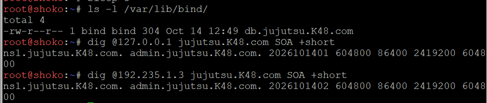

---

## 📦 Soal 12: A Record, CNAME, Reverse DNS, dan Forwarder

### Soal 12: Penyampaian Ulang

> Peta domain harus memetakan pintu masuk utama dan tetap bisa mencari alamat di luar kawasan Shibuya. Pada utahime, buat A record jujutsu.K48.com yang mengarah ke gojo, serta CNAME www yang merujuk ke domain utama tersebut. Buat pula Reverse DNS (zona PTR) untuk melacak IP gojo kembali ke domain resminya, dan aktifkan fitur DNS Forwarder pada BIND9 mengarah ke IP gateway internet (192.168.122.1). Uji dari client dengan dig untuk mengecek CNAME, PTR, dan buktikan client tetap bisa melakukan ping ke domain internet seperti google.com.

### 🎯 Maksud dari Soal No. 12

Zona di soal 11 masih kosong, hanya berisi data administratif. Soal ini mengisinya dengan data yang berguna dan memastikan klien tidak kehilangan akses ke internet.

1. **A record (apex):** memetakan nama `jujutsu.K48.com` ke alamat IP gojo (`192.235.1.4`). Dengan ini orang cukup mengetik nama domain untuk sampai ke gerbang publik.
2. **CNAME `www`:** alias dari `www.jujutsu.K48.com` ke `jujutsu.K48.com`. Alias selalu mengikuti tujuannya, jadi kalau IP gojo berubah cukup satu record yang diubah.
3. **Reverse DNS (PTR):** kebalikan dari A record, yaitu dari IP ke nama. Nama zonanya memakai oktet terbalik: jaringan `192.235.1.x` menjadi `1.235.192.in-addr.arpa`. Angka `4` pada record PTR adalah oktet terakhir IP gojo.
4. **DNS Forwarder:** klien kita hanya diberi DNS utahime dan shoko (lewat DHCP). Kedua server hanya tahu isi zona `jujutsu.K48.com`, sehingga nama lain seperti `google.com` tidak akan terjawab. Dengan forwarder, pertanyaan di luar zona diteruskan ke `192.168.122.1` yang punya akses internet.

Karena zona reverse juga disalin ke shoko, shoko mendapat deklarasi zona reverse sebagai Slave.

### 🛠️ Cara Mengerjakan

1. **Di utahime, buat skrip** `nano /root/soal12_utahime.sh`. Skrip ini menulis ulang `named.conf.local` (menambahkan zona reverse), file zona forward (A record, CNAME, serial dinaikkan ke `2026101403`), file zona reverse (PTR), dan `named.conf.options` (forwarder).
2. **Jalankan skrip utahime**, tunggu kedua `named-checkzone` mencetak `OK`.
3. **Di shoko, buat skrip** `nano /root/soal12_shoko.sh`. Skrip ini menambahkan zona reverse sebagai slave dan mengatur forwarder yang sama.
4. **Jalankan skrip shoko**, lalu cek bahwa kedua file zona tersalin.
5. **Uji dari klien** dengan `dig` dan `ping`.

#### Konfigurasi utahime — `/root/soal12_utahime.sh`

```bash
#!/bin/bash
cat > /etc/bind/named.conf.local <<'EOF'
zone "jujutsu.K48.com" {
    type master;
    file "/etc/bind/jujutsu/db.jujutsu.K48.com";
    notify yes;
    allow-transfer { 192.235.1.3; };
    also-notify   { 192.235.1.3; };
};
zone "1.235.192.in-addr.arpa" {
    type master;
    file "/etc/bind/jujutsu/db.192.235.1";
    notify yes;
    allow-transfer { 192.235.1.3; };
    also-notify   { 192.235.1.3; };
};
EOF

cat > /etc/bind/jujutsu/db.jujutsu.K48.com <<'EOF'
$TTL 604800
@   IN SOA ns1.jujutsu.K48.com. admin.jujutsu.K48.com. (
            2026101403 ; serial
            604800
            86400
            2419200
            604800 )
@   IN NS ns1.jujutsu.K48.com.
@   IN NS ns2.jujutsu.K48.com.
ns1 IN A 192.235.1.2
ns2 IN A 192.235.1.3
@   IN A 192.235.1.4
www IN CNAME jujutsu.K48.com.
EOF

cat > /etc/bind/jujutsu/db.192.235.1 <<'EOF'
$TTL 604800
@   IN SOA ns1.jujutsu.K48.com. admin.jujutsu.K48.com. (
            2026101401 ; serial
            604800
            86400
            2419200
            604800 )
@   IN NS ns1.jujutsu.K48.com.
@   IN NS ns2.jujutsu.K48.com.
2   IN PTR ns1.jujutsu.K48.com.
3   IN PTR ns2.jujutsu.K48.com.
4   IN PTR jujutsu.K48.com.
EOF

cat > /etc/bind/named.conf.options <<'EOF'
options {
    directory "/var/cache/bind";
    forwarders { 192.168.122.1; };
    forward only;
    dnssec-validation no;
    allow-query { any; };
    allow-recursion { any; };
    listen-on { any; };
    listen-on-v6 { none; };
};
EOF

chown -R bind:bind /etc/bind/jujutsu
named-checkconf
named-checkzone jujutsu.K48.com /etc/bind/jujutsu/db.jujutsu.K48.com
named-checkzone 1.235.192.in-addr.arpa /etc/bind/jujutsu/db.192.235.1
service named restart || service bind9 restart
```

#### Konfigurasi shoko — `/root/soal12_shoko.sh`

```bash
#!/bin/bash
cat > /etc/bind/named.conf.local <<'EOF'
zone "jujutsu.K48.com" {
    type slave;
    masters { 192.235.1.2; };
    file "/var/lib/bind/db.jujutsu.K48.com";
};
zone "1.235.192.in-addr.arpa" {
    type slave;
    masters { 192.235.1.2; };
    file "/var/lib/bind/db.192.235.1";
};
EOF

cat > /etc/bind/named.conf.options <<'EOF'
options {
    directory "/var/cache/bind";
    forwarders { 192.168.122.1; };
    forward only;
    dnssec-validation no;
    allow-query { any; };
    allow-recursion { any; };
    listen-on { any; };
    listen-on-v6 { none; };
};
EOF

named-checkconf
service named restart || service bind9 restart
```

#### Penjelasan baris penting

| Baris | Fungsi |
| --- | --- |
| `@ IN A 192.235.1.4` | Nama utama `jujutsu.K48.com` mengarah ke gojo |
| `www IN CNAME jujutsu.K48.com.` | `www` adalah alias dari nama utama (titik di akhir wajib) |
| `zone "1.235.192.in-addr.arpa"` | Zona reverse untuk jaringan `192.235.1.0/24` |
| `4 IN PTR jujutsu.K48.com.` | IP `192.235.1.4` dilacak kembali ke nama domain |
| `forwarders { 192.168.122.1; };` | Query di luar zona diteruskan ke gateway internet |
| `forward only;` | Tidak mencoba resolusi sendiri, hanya meneruskan |
| `dnssec-validation no;` | Mencegah kegagalan validasi pada jawaban dari forwarder lokal |
| `allow-recursion { any; };` | Mengizinkan klien meminta pencarian rekursif (diperlukan agar `google.com` terjawab) |

#### Cara menjalankan

Jalankan `bash /root/soal12_utahime.sh` di utahime, tunggu kedua `named-checkzone` mencetak `OK`, baru `bash /root/soal12_shoko.sh` di shoko.

### ✅ Cara Melakukan Validasi

1. **Cek shoko menyalin kedua zona.**

```bash
# di shoko
sleep 5
ls -l /var/lib/bind/
dig @127.0.0.1 jujutsu.K48.com SOA +short
```

2. **Uji dari klien (kusakabe), DNS sudah dari DHCP sehingga tanpa `@`:**

```bash
dig www.jujutsu.K48.com CNAME +short
dig jujutsu.K48.com A +short
dig -x 192.235.1.4 +short
dig @192.235.1.3 -x 192.235.1.4 +short
ping -c 3 google.com
```

#### Hasil

Shoko menyalin zona forward dan reverse dengan serial `2026101403`:

```text
root@shoko:~# bash /root/soal12_shoko.sh
Stopping domain name service...: named
Starting domain name service...: named.
root@shoko:~# ls -l /var/lib/bind/
-rw-r--r-- 1 bind bind 427 Oct 14 13:57 db.192.235.1
-rw-r--r-- 1 bind bind 407 Oct 14 13:21 db.jujutsu.K48.com
root@shoko:~# dig @127.0.0.1 jujutsu.K48.com SOA +short
ns1.jujutsu.K48.com. admin.jujutsu.K48.com. 2026101403 604800 86400 2419200 604800
```

Pengujian dari klien:

```text
kusakabe:~# dig www.jujutsu.K48.com CNAME +short
jujutsu.K48.com.
kusakabe:~# dig jujutsu.K48.com A +short
192.235.1.4
kusakabe:~# dig -x 192.235.1.4 +short
jujutsu.K48.com.
kusakabe:~# dig @192.235.1.3 -x 192.235.1.4 +short
jujutsu.K48.com.
kusakabe:~# ping -c 3 google.com
3 packets transmitted, 3 received, 0% packet loss, time 2218ms
rtt min/avg/max/mdev = 21.668/22.217/22.707/0.426 ms
```

**Mengapa ini membuktikan soal terpenuhi:**

- `www` terjawab sebagai alias `jujutsu.K48.com.`, jadi CNAME benar.
- Nama utama mengarah ke `192.235.1.4`, yaitu IP gojo.
- Pencarian balik `-x` menghasilkan `jujutsu.K48.com.`, baik dari Master maupun dari Slave, jadi PTR benar dan tersalin.
- `ping google.com` berhasil padahal DNS klien hanya utahime dan shoko. Itu hanya mungkin kalau forwarder bekerja.

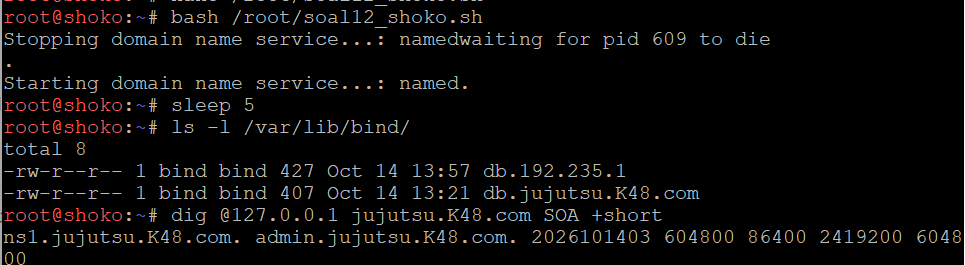
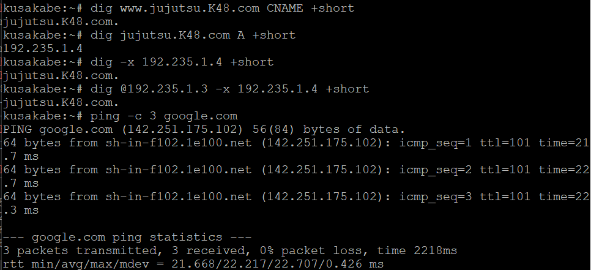

---

## 📦 Soal 13: Replikasi MariaDB Master-Slave (yaga dan inumaki)

### Soal 13: Penyampaian Ulang

> Kepala Sekolah Yaga dan Inumaki mendirikan database terpusat yang redundan agar log aktivitas kutukan tetap aman tersimpan. Konfigurasikan MariaDB pada yaga sebagai DB-Master dan inumaki sebagai DB-Slave. Buat database db_shibuya_K48 beserta tabel request_logs di Master, aktifkan binary logging (log-bin, server-id), lalu hubungkan inumaki sebagai Slave yang menyalin data secara realtime dengan CHANGE MASTER TO. Berikan hak akses remote bagi seluruh node di Network 4, lalu buktikan replikasi berhasil dengan memasukkan data baru di Master dan memeriksa hasilnya di Slave.

### 🎯 Maksud dari Soal No. 13

Log aktivitas dari semua worker API akan disimpan di satu database. Kalau database itu rusak, semua log hilang, jadi dibuat **dua** database yang isinya selalu sama.

1. **Master (yaga):** database utama tempat data ditulis.
2. **Slave (inumaki):** salinan yang terus diperbarui otomatis. Isinya selalu mengikuti Master.
3. **Binary log (`log_bin`):** catatan semua perubahan data di Master (seperti buku harian). Tanpa binlog, Slave tidak punya bahan untuk ditiru.
4. **`server-id`:** nomor unik tiap server (Master = 1, Slave = 2). Replikasi menolak dua server dengan nomor sama.
5. **Cara kerja Slave:** satu proses (IO thread) mengambil binlog dari Master dan menyimpannya di *relay log*, proses lain (SQL thread) menjalankan isi relay log di database Slave. Keduanya harus `Yes` agar replikasi sehat.
6. **`CHANGE MASTER TO`:** perintah yang memberi tahu Slave dari mana ia menyalin (alamat Master, user, password, nama binlog, dan posisi awal).
7. **User replikasi dan user aplikasi:** `repl` hanya punya hak `REPLICATION SLAVE` untuk Slave. `shibuya` punya hak penuh atas `db_shibuya_K48` dan dipakai worker API. Keduanya dibatasi untuk host `192.235.4.%`, yaitu seluruh node Network 4 (itulah arti "hak akses remote bagi seluruh node Network 4").
8. **Kolom `client_ip`:** sudah dibuat dari sekarang karena dibutuhkan pada soal 17.

Slave dimulai dari posisi awal binlog (`MASTER_LOG_POS=4`) supaya perintah `CREATE DATABASE` dan `CREATE TABLE` ikut tereplikasi. Dengan begitu Slave tidak perlu dibuatkan database secara manual.

### 🛠️ Cara Mengerjakan

1. **Siapkan yaga (Master):** pastikan IP `192.235.4.3`, gateway, dan internet siap.
2. **Buat skrip Master** `nano /root/soal13_yaga.sh`. Skrip memasang MariaDB, mengaktifkan `bind-address = 0.0.0.0` (agar bisa diakses dari node lain), `server-id = 1`, dan `log_bin`, lalu membuat database, tabel, dan kedua user.
3. **Jalankan skrip Master**, lalu catat nama binlog pertama dari `SHOW BINARY LOGS` (di sini `mysql-bin.000001`).
4. **Siapkan inumaki (Slave):** pastikan IP `192.235.4.4`, dan yaga bisa di-ping (`ping 192.235.4.3`).
5. **Buat skrip Slave** `nano /root/soal13_inumaki.sh`. Skrip ini mengatur `server-id = 2` dan `relay-log`, lalu menjalankan `CHANGE MASTER TO` dan `START SLAVE`.
6. **Jalankan skrip Slave**, lalu cek status replikasi.
7. **Buktikan replikasi** dengan menambah data di Master dan membacanya di Slave.

#### Konfigurasi yaga — `/root/soal13_yaga.sh`

```bash
#!/bin/bash
echo "nameserver 192.168.122.1" > /etc/resolv.conf
apt-get update && apt-get install -y mariadb-server mariadb-client

[ -d /var/lib/mysql/mysql ] || mariadb-install-db --user=mysql --datadir=/var/lib/mysql

mkdir -p /var/log/mysql && chown mysql:mysql /var/log/mysql
cat > /etc/mysql/mariadb.conf.d/99-shibuya.cnf <<'EOF'
[mysqld]
bind-address = 0.0.0.0
server-id    = 1
log_bin      = /var/log/mysql/mysql-bin.log
skip-name-resolve
EOF

service mariadb restart || service mysql restart
for i in $(seq 1 30); do
  mariadb -e "SELECT 1" >/dev/null 2>&1 && break
  sleep 1
done

mariadb <<'EOF'
CREATE DATABASE IF NOT EXISTS db_shibuya_K48;
USE db_shibuya_K48;
CREATE TABLE IF NOT EXISTS request_logs (
  id INT AUTO_INCREMENT PRIMARY KEY,
  hostname VARCHAR(64),
  client_ip VARCHAR(45),
  path VARCHAR(255),
  created_at TIMESTAMP DEFAULT CURRENT_TIMESTAMP
);
CREATE USER IF NOT EXISTS 'repl'@'192.235.4.%'    IDENTIFIED BY 'repl123';
GRANT REPLICATION SLAVE ON *.* TO 'repl'@'192.235.4.%';
CREATE USER IF NOT EXISTS 'shibuya'@'192.235.4.%' IDENTIFIED BY 'shibuya123';
GRANT ALL PRIVILEGES ON db_shibuya_K48.* TO 'shibuya'@'192.235.4.%';
FLUSH PRIVILEGES;
EOF

mariadb -e "SHOW MASTER STATUS; SHOW BINARY LOGS;"
```

#### Konfigurasi inumaki — `/root/soal13_inumaki.sh`

```bash
#!/bin/bash
echo "nameserver 192.168.122.1" > /etc/resolv.conf
apt-get update && apt-get install -y mariadb-server mariadb-client

[ -d /var/lib/mysql/mysql ] || mariadb-install-db --user=mysql --datadir=/var/lib/mysql

mkdir -p /var/log/mysql && chown mysql:mysql /var/log/mysql
cat > /etc/mysql/mariadb.conf.d/99-shibuya.cnf <<'EOF'
[mysqld]
bind-address = 0.0.0.0
server-id    = 2
relay-log    = /var/log/mysql/relay-bin
skip-name-resolve
EOF

service mariadb restart || service mysql restart
for i in $(seq 1 30); do
  mariadb -e "SELECT 1" >/dev/null 2>&1 && break
  sleep 1
done

# MASTER_LOG_FILE = binlog pertama dari "SHOW BINARY LOGS" di yaga
mariadb <<'EOF'
STOP SLAVE;
CHANGE MASTER TO
  MASTER_HOST='192.235.4.3',
  MASTER_USER='repl',
  MASTER_PASSWORD='repl123',
  MASTER_LOG_FILE='mysql-bin.000001',
  MASTER_LOG_POS=4;
START SLAVE;
EOF

sleep 3
mariadb -e "SHOW SLAVE STATUS\G" | grep -E "Master_Host|Slave_IO_Running|Slave_SQL_Running|Last_.*Error|Seconds_Behind"
```

#### Penjelasan baris penting

| Baris | Fungsi |
| --- | --- |
| `bind-address = 0.0.0.0` | Mau menerima koneksi dari node lain (bawaan hanya `127.0.0.1`) |
| `server-id = 1` / `2` | Nomor unik Master dan Slave |
| `log_bin = ...` | Mengaktifkan binary log di Master |
| `relay-log = ...` | Tempat Slave menyimpan log yang ditarik dari Master |
| `skip-name-resolve` | Hak akses dicocokkan berdasarkan IP, tanpa lookup nama |
| `'repl'@'192.235.4.%'` | User replikasi, hanya dari Network 4 |
| `'shibuya'@'192.235.4.%'` | User aplikasi untuk worker, hanya dari Network 4 |
| `MASTER_LOG_POS=4` | Mulai membaca dari awal binlog agar `CREATE DATABASE/TABLE` ikut tersalin |

#### Cara menjalankan

Jalankan **yaga dulu sampai selesai**, catat nama binlog pertama dari `SHOW BINARY LOGS`, baru jalankan inumaki.

### ✅ Cara Melakukan Validasi

1. **Cek Master:**

```bash
# yaga
ss -ltnp | grep 3306
mariadb -e "SHOW VARIABLES LIKE 'server_id'; SHOW VARIABLES LIKE 'log_bin';"
mariadb -e "SHOW TABLES FROM db_shibuya_K48;"
mariadb -e "SELECT user,host FROM mysql.user WHERE user IN ('repl','shibuya');"
mariadb -e "SHOW BINARY LOGS;"
cat /etc/mysql/mariadb.conf.d/99-shibuya.cnf
```

2. **Cek status Slave:**

```bash
# inumaki
mariadb -e "SHOW SLAVE STATUS\G" | grep -E "Master_Host|Slave_IO_Running|Slave_SQL_Running|Last_.*Error|Seconds_Behind"
mariadb -e "SHOW DATABASES;"
mariadb -e "SHOW TABLES FROM db_shibuya_K48;"
```

3. **Buktikan replikasi realtime:**

```bash
# yaga: tambah data
mariadb -e "INSERT INTO db_shibuya_K48.request_logs(hostname,client_ip,path) VALUES('tes-master','1.1.1.1','/tes');"
mariadb -e "SELECT * FROM db_shibuya_K48.request_logs;"
# inumaki: data harus sudah muncul
mariadb -e "SELECT * FROM db_shibuya_K48.request_logs;"
```

4. **Buktikan hak akses remote** (dari inumaki ke yaga memakai user `shibuya`):

```bash
mariadb -h 192.235.4.3 -u shibuya -pshibuya123 -e "SELECT CURRENT_USER(); SHOW DATABASES; SELECT COUNT(*) FROM db_shibuya_K48.request_logs;"
```

5. **Bersihkan data tes:**

```bash
# yaga
mariadb -e "DELETE FROM db_shibuya_K48.request_logs WHERE hostname='tes-master';"
```

#### Hasil

Master (yaga) mendengarkan di semua interface, binary log aktif, dan user remote terdaftar:

```text
LISTEN 0 80 0.0.0.0:3306 0.0.0.0:* users:(("mariadbd",...))
server_id | 1          log_bin | ON
Tables_in_db_shibuya_K48: request_logs
repl    | 192.235.4.%
shibuya | 192.235.4.%
mysql-bin.000001 | 1731
```

Konfigurasi `/etc/mysql/mariadb.conf.d/99-shibuya.cnf` di yaga:

```text
[mysqld]
bind-address = 0.0.0.0
server-id    = 1
log_bin      = /var/log/mysql/mysql-bin.log
skip-name-resolve
```

Slave (inumaki) terhubung ke Master dan tidak tertinggal:

```text
Master_Host: 192.235.4.3
Slave_IO_Running: Yes
Slave_SQL_Running: Yes
Last_IO_Error:
Last_SQL_Error:
Seconds_Behind_Master: 0
Slave_SQL_Running_State: Slave has read all relay log; waiting for more updates
```

Database dan tabel muncul di inumaki tanpa dibuat manual, dan data yang dimasukkan di Master langsung terlihat di Slave:

```text
Master (yaga)  : | 1 | tes-master | 1.1.1.1 | /tes | 2026-10-14 14:18:27 |
Slave (inumaki): | 1 | tes-master | 1.1.1.1 | /tes | 2026-10-14 14:18:27 |
```

Akses remote dari node Network 4 berhasil (dijalankan dari inumaki ke yaga):

```text
CURRENT_USER() = shibuya@192.235.4.%
Database: db_shibuya_K48, information_schema
COUNT(*) = 1
```

Pemeriksaan akhir setelah seluruh soal selesai, replikasi di inumaki tetap sehat:

```text
root@inumaki:~# mariadb -e "SELECT 1"
| 1 |
root@inumaki:~# mariadb -e "SHOW SLAVE STATUS\G" | grep -E "Slave_IO_Running|Slave_SQL_Running"
Slave_IO_Running: Yes
Slave_SQL_Running: Yes
```

**Mengapa ini membuktikan soal terpenuhi:** `log_bin = ON` dan `server_id = 1` membuktikan Master siap. `Yes/Yes` dengan `Seconds_Behind_Master: 0` menunjukkan Slave terhubung dan tidak tertinggal. Baris `tes-master` yang hanya dimasukkan di yaga dan muncul di inumaki membuktikan penyalinan berjalan otomatis. Login `shibuya@192.235.4.%` dari node lain membuktikan hak akses remote Network 4 bekerja.

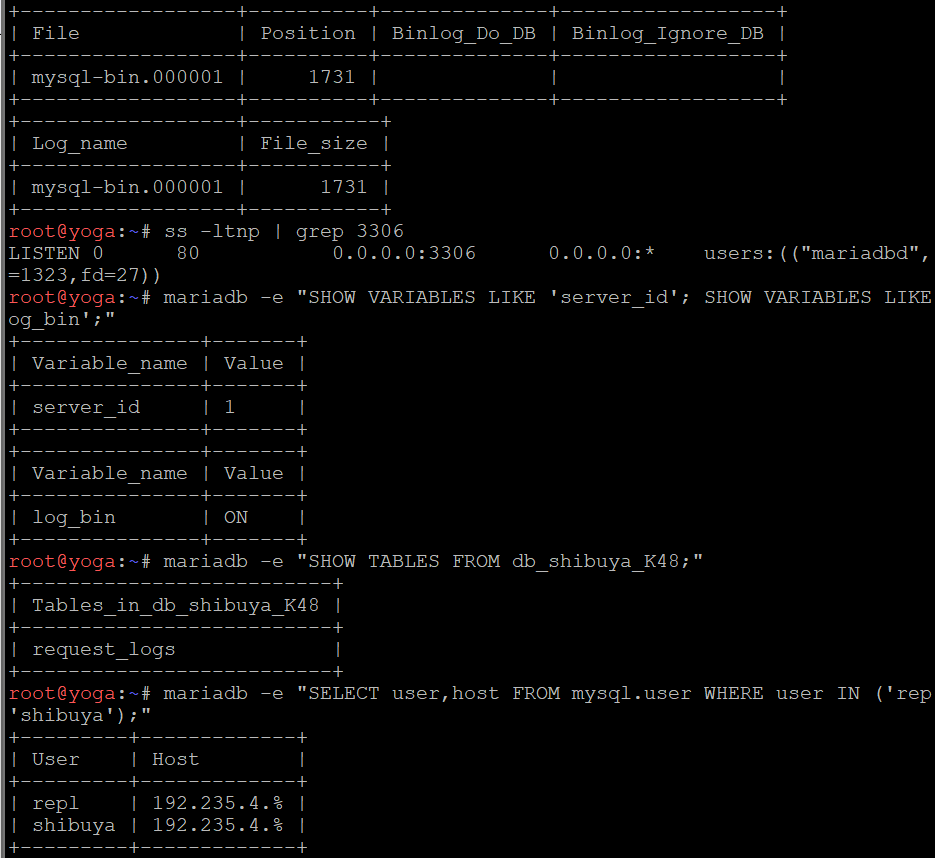
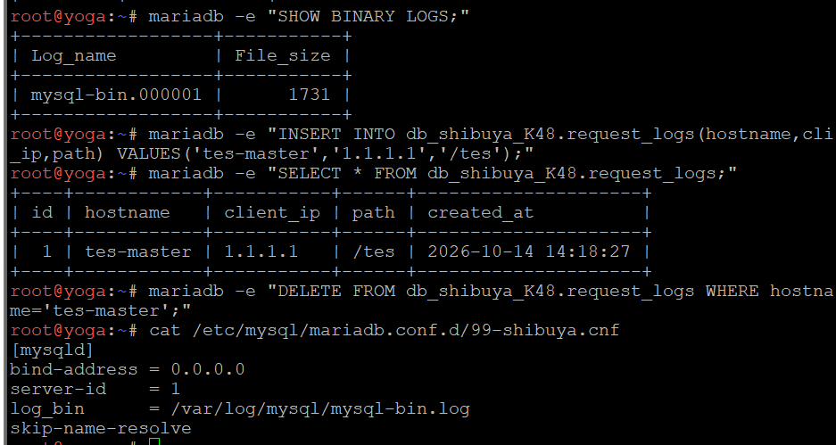
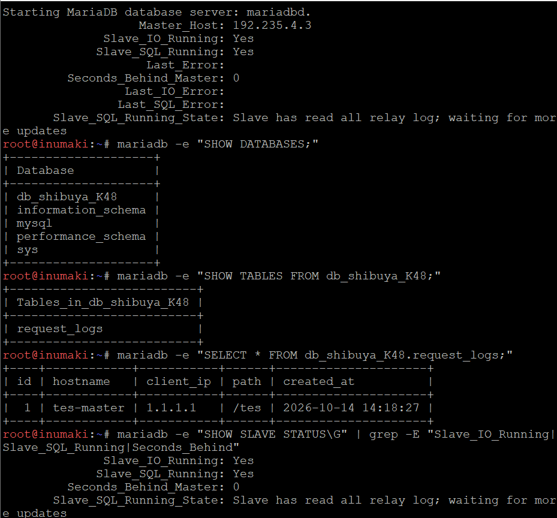
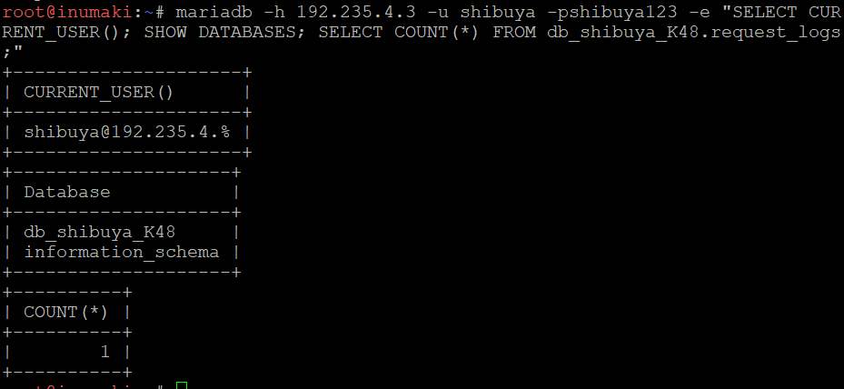
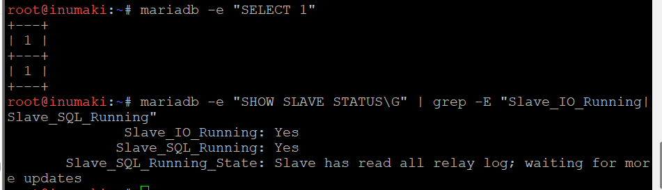

---

## 📦 Soal 14: Worker Frontend dan API

### Soal 14: Penyampaian Ulang

> Para penyihir lapangan bersiaga di Data Center sebagai pekerja backend untuk memproses aplikasi. Pasang Nginx dan PHP-FPM pada maki dan panda untuk menyajikan web frontend yang menampilkan hostname masing-masing. Pada nanami, todo, dan kirara, siapkan layanan API yang mencatat log request ke database yaga. Konfigurasikan virtual host agar worker merespons domain layanan yang ditentukan. Batasi akses langsung dari klien ke worker, web worker hanya menerima trafik melalui jalur proxy web yang ditentukan, sedangkan worker API hanya menerima trafik melalui geto. Uji bahwa akses langsung dari klien ditolak, sementara akses melalui reverse proxy tetap berhasil.

### 🎯 Maksud dari Soal No. 14

Soal ini membangun "pekerja" yang sebenarnya melayani permintaan. Ada dua jenis pekerja dengan tugas berbeda:

1. **Worker frontend (maki, panda):** menyajikan halaman web yang menampilkan nama hostname. Nama itu menjadi penanda untuk melihat worker mana yang menjawab saat pembagian beban diuji.
2. **Worker API (nanami, todo, kirara):** menerima request ke `/api`, mencatatnya ke tabel `request_logs` di yaga, lalu membalas JSON berisi nama worker dan status.
3. **Nginx dan PHP-FPM bekerja berpasangan.** Nginx menerima request HTTP. Kalau yang diminta adalah file PHP, Nginx menyerahkannya ke PHP-FPM lewat socket (protokol FastCGI), lalu PHP-FPM mengeksekusi kodenya dan mengembalikan hasilnya.
4. **Virtual host (`server_name`):** worker dikonfigurasi menjawab untuk nama domain layanan (`jujutsu.K48.com`).
5. **Pembatasan akses dengan `allow`/`deny`:** worker frontend hanya menerima dari gojo (`192.235.1.4`), dan worker API hanya dari geto (`192.235.4.5`). Request dari alamat lain, termasuk klien yang menembak langsung IP worker, ditolak dengan `403 Forbidden`.
6. **Pengecekan IP klien di API:** skrip API hanya memercayai header `X-Real-IP` kalau koneksinya datang dari geto. Bagian ini baru dipakai di soal 17, tetapi sudah ditanam sekarang agar skrip tidak perlu diubah lagi.

### 🛠️ Cara Mengerjakan

Lakukan di tiap kelompok worker.

**A. Frontend (maki dan panda, skripnya sama):**

1. Cek jaringan dan internet node.
2. Buat skrip `nano /root/soal14_frontend.sh` (isi di bawah).
3. Periksa dengan `cat` dan `bash -n`, lalu jalankan.
4. Cek `curl` lokal menampilkan nama hostname.

**B. API (nanami, todo, dan kirara, skripnya sama):**

1. Cek jaringan, termasuk koneksi ke yaga (`ping 192.235.4.3`).
2. Buat skrip `nano /root/soal14_api.sh` (isi di bawah).
3. Periksa dengan `cat` dan `bash -n`, lalu jalankan.
4. Cek `curl` lokal ke `/api` menampilkan `"status":"ok"`, yang membuktikan worker bisa menulis ke database.

**C. Uji pembatasan akses** dari klien ke semua IP worker.

#### Konfigurasi maki dan panda — `/root/soal14_frontend.sh`

```bash
#!/bin/bash
GOJO_IP=192.235.1.4

echo "nameserver 192.168.122.1" > /etc/resolv.conf
apt-get update && apt-get install -y nginx php-fpm curl
PHPV=$(php -r 'echo PHP_MAJOR_VERSION.".".PHP_MINOR_VERSION;')

mkdir -p /var/www/frontend
cat > /var/www/frontend/index.php <<'EOF'
<?php
echo "<h1>Frontend Worker: " . gethostname() . "</h1>\n";
EOF

cat > /etc/nginx/sites-available/frontend <<'EOF'
server {
    listen 80 default_server;
    server_name jujutsu.K48.com www.jujutsu.K48.com;
    root /var/www/frontend;
    index index.php;

    # hanya menerima trafik dari gojo (reverse proxy)
    allow __GOJO_IP__;
    allow 127.0.0.1;
    deny all;

    location / {
        try_files $uri $uri/ /index.php?$query_string;
    }
    location ~ \.php$ {
        include snippets/fastcgi-php.conf;
        fastcgi_pass unix:/run/php/php__PHPV__-fpm.sock;
    }
}
EOF
sed -i "s/__GOJO_IP__/$GOJO_IP/; s/__PHPV__/$PHPV/" /etc/nginx/sites-available/frontend

rm -f /etc/nginx/sites-enabled/default
ln -sf /etc/nginx/sites-available/frontend /etc/nginx/sites-enabled/frontend

service php${PHPV}-fpm restart
nginx -t && service nginx restart
```

#### Konfigurasi nanami, todo, dan kirara — `/root/soal14_api.sh`

```bash
#!/bin/bash
GETO_IP=192.235.4.5
DB_IP=192.235.4.3

echo "nameserver 192.168.122.1" > /etc/resolv.conf
apt-get update && apt-get install -y nginx php-fpm php-mysql curl
PHPV=$(php -r 'echo PHP_MAJOR_VERSION.".".PHP_MINOR_VERSION;')

mkdir -p /var/www/api
cat > /var/www/api/index.php <<'EOF'
<?php
header('Content-Type: application/json');
$host   = gethostname();
$remote = $_SERVER['REMOTE_ADDR'];

// hanya header dari geto yang dipercaya
$trusted_proxy = ['__GETO_IP__'];
$client_ip = $remote;
if (in_array($remote, $trusted_proxy) && !empty($_SERVER['HTTP_X_REAL_IP'])
    && filter_var($_SERVER['HTTP_X_REAL_IP'], FILTER_VALIDATE_IP)) {
    $client_ip = $_SERVER['HTTP_X_REAL_IP'];
}

$status = 'ok';
mysqli_report(MYSQLI_REPORT_OFF);
$db = @new mysqli('__DB_IP__', 'shibuya', 'shibuya123', 'db_shibuya_K48');
if ($db->connect_errno) {
    $status = 'db_error';
} else {
    $path = $_SERVER['REQUEST_URI'];
    $st = $db->prepare("INSERT INTO request_logs (hostname, client_ip, path) VALUES (?,?,?)");
    $st->bind_param('sss', $host, $client_ip, $path);
    $st->execute();
}
echo json_encode(['worker' => $host, 'client_ip' => $client_ip, 'status' => $status]);
EOF
sed -i "s/__GETO_IP__/$GETO_IP/; s/__DB_IP__/$DB_IP/" /var/www/api/index.php

cat > /etc/nginx/sites-available/api <<'EOF'
server {
    listen 80 default_server;
    server_name jujutsu.K48.com www.jujutsu.K48.com;
    root /var/www/api;

    # hanya menerima trafik dari geto (load balancer)
    allow __GETO_IP__;
    allow 127.0.0.1;
    deny all;

    location / {
        include fastcgi_params;
        fastcgi_param SCRIPT_FILENAME $document_root/index.php;
        fastcgi_pass unix:/run/php/php__PHPV__-fpm.sock;
    }
}
EOF
sed -i "s/__GETO_IP__/$GETO_IP/; s/__PHPV__/$PHPV/" /etc/nginx/sites-available/api

rm -f /etc/nginx/sites-enabled/default
ln -sf /etc/nginx/sites-available/api /etc/nginx/sites-enabled/api

service php${PHPV}-fpm restart
nginx -t && service nginx restart
```

#### Penjelasan baris penting

| Baris | Fungsi |
| --- | --- |
| `PHPV=$(php -r ...)` | Mendeteksi versi PHP (di sini 8.4) agar nama socket PHP-FPM selalu benar |
| `server_name jujutsu.K48.com ...` | Virtual host untuk domain layanan |
| `allow ...; deny all;` | Hanya proxy yang ditentukan boleh masuk, lainnya mendapat `403` |
| `fastcgi_pass unix:/run/php/php8.4-fpm.sock;` | Menyerahkan eksekusi PHP ke PHP-FPM lewat socket |
| `fastcgi_param SCRIPT_FILENAME .../index.php` | Semua path (`/api`, `/api/x`, dst.) dijalankan oleh satu skrip API |
| `gethostname()` | Menampilkan nama node sehingga worker yang menjawab terlihat |
| `INSERT INTO request_logs ...` | Mencatat setiap request ke database di yaga |
| `in_array($remote, $trusted_proxy)` | `X-Real-IP` hanya dipercaya kalau koneksi berasal dari geto |

### ✅ Cara Melakukan Validasi

1. **Cek layanan dan respons lokal di tiap worker:**

```bash
pgrep -a nginx | head -2
pgrep -a php-fpm | head -2
curl -s -H "Host: jujutsu.K48.com" http://127.0.0.1/      # maki, panda
curl -s http://127.0.0.1/api                              # nanami, todo, kirara
```

2. **Cek data masuk ke database di yaga:**

```bash
mariadb -e "SELECT id,hostname,client_ip,path FROM db_shibuya_K48.request_logs ORDER BY id DESC LIMIT 5;"
```

3. **Uji akses langsung dari klien (harus ditolak):**

```bash
for ip in 192.235.4.6 192.235.4.7 192.235.4.8 192.235.4.9 192.235.4.2; do
  curl -s -o /dev/null -w "$ip -> HTTP %{http_code}\n" http://$ip/
done
for ip in 192.235.4.8 192.235.4.9 192.235.4.2; do
  curl -s -o /dev/null -w "$ip /api -> HTTP %{http_code}\n" http://$ip/api
done
```

4. **Uji akses lewat reverse proxy (harus berhasil):** dibuktikan pada soal 15 (lewat geto) dan soal 16 (lewat gojo).

#### Hasil

Nginx dan PHP-FPM 8.4 berjalan di semua worker. Frontend menampilkan hostname masing-masing, dan API mencatat ke database:

```text
root@maki:~#  <h1>Frontend Worker: maki</h1>
root@panda:~# <h1>Frontend Worker: panda</h1>
{"worker":"nanami","client_ip":"127.0.0.1","status":"ok"}
{"worker":"todo","client_ip":"127.0.0.1","status":"ok"}
{"worker":"kirara","client_ip":"127.0.0.1","status":"ok"}
```

Data dari ketiga worker API masuk ke database di yaga:

```text
| id | hostname | client_ip | path |
|  4 | kirara   | 127.0.0.1 | /api |
|  3 | todo     | 127.0.0.1 | /api |
|  2 | nanami   | 127.0.0.1 | /api |
```

Akses langsung dari klien ke semua worker ditolak:

```text
192.235.4.6 -> HTTP 403          192.235.4.8 /api -> HTTP 403
192.235.4.7 -> HTTP 403          192.235.4.9 /api -> HTTP 403
192.235.4.8 -> HTTP 403          192.235.4.2 /api -> HTTP 403
192.235.4.9 -> HTTP 403
192.235.4.2 -> HTTP 403
```

**Mengapa ini membuktikan soal terpenuhi:** `"status":"ok"` dan baris di database menunjukkan API benar-benar mencatat ke yaga. Hostname berbeda di tiap worker menunjukkan masing-masing berjalan sendiri. Semua `403` dari klien membuktikan pembatasan akses bekerja. Request yang sama berhasil jika datang lewat proxy yang diizinkan (soal 15 dan 16).

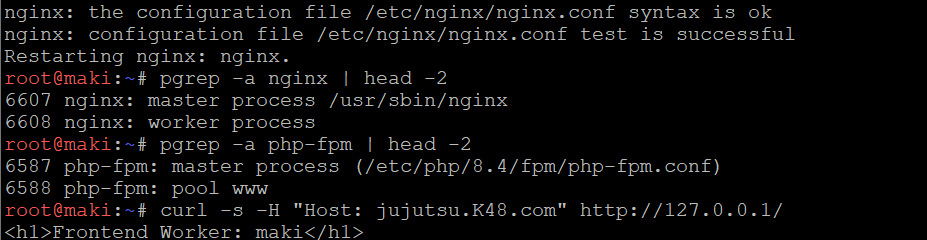
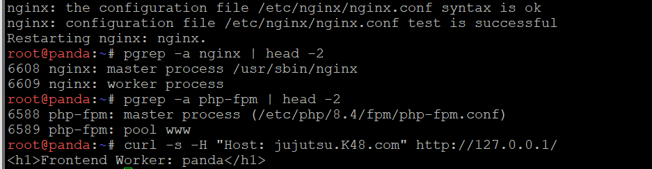
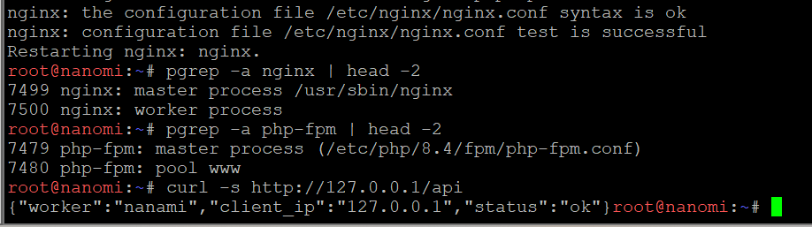
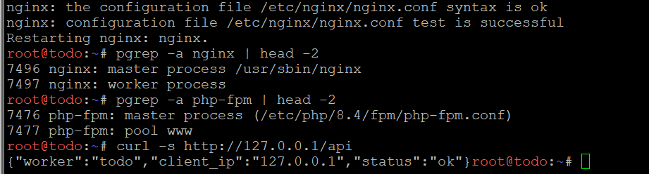
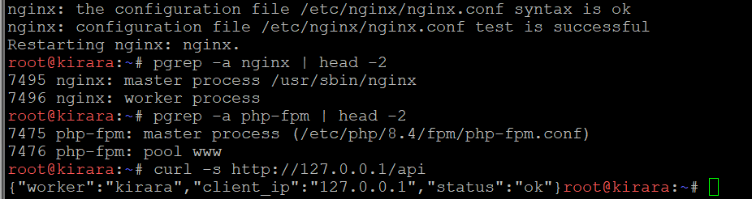
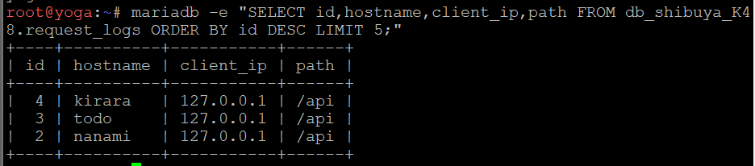
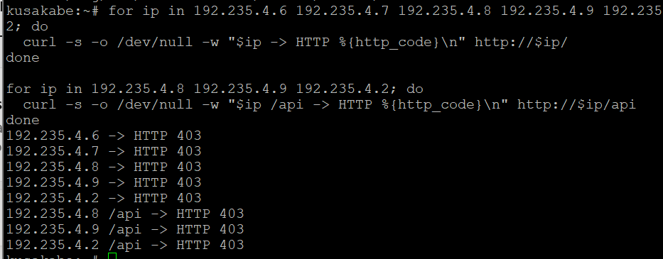

---

## 📦 Soal 15: Load Balancer geto (Weighted Round Robin 3:1)

### Soal 15: Penyampaian Ulang

> Geto bertugas mengendalikan pembagian beban request API di internal Data Center agar server tidak tumbang bersamaan. Konfigurasikan Nginx pada geto sebagai Load Balancer internal dengan upstream api_cluster yang mengarahkan trafik ke nanami dan todo. Terapkan algoritma Weighted Round Robin dengan bobot 3:1, di mana nanami menerima porsi beban tiga kali lebih banyak daripada todo. Buktikan distribusi beban ini dengan melakukan loop request berulang kali ke geto dari jaringan lokal Data Center dan periksa rasio responnya.

### 🎯 Maksud dari Soal No. 15

Kalau semua request ke `/api` ditujukan ke satu worker, worker itu bisa kewalahan. Geto bertugas sebagai **load balancer**: menerima semua request API lalu membaginya ke beberapa worker.

1. **Upstream (`api_cluster`):** kelompok server tujuan, yaitu nanami dan todo.
2. **Round Robin:** request dibagi bergiliran, satu ke tiap server.
3. **Weighted Round Robin:** giliran diberi **bobot**. Dengan bobot 3:1, dari setiap 4 request, 3 ke nanami dan 1 ke todo. Cara ini cocok kalau satu server lebih kuat dari yang lain.
4. **Smooth weighted round robin:** nginx tidak mengirim 3 request berturut-turut ke nanami lalu 1 ke todo. Request todo diselipkan di antara request nanami, sehingga pola `nanami, todo, nanami, nanami` terlihat berulang.
5. **Pembuktian:** loop request dari jaringan Data Center (di sini dari maki) lalu hitung jumlah respons tiap worker. Rasio yang diharapkan mendekati 3:1.

Soal ini dikerjakan bertahap. Versi akhir geto yang sudah memuat soal 15, 17, dan 18 ada pada `/root/soal18_geto.sh`.

### 🛠️ Cara Mengerjakan

1. Pastikan semua worker API dari soal 14 sudah berjalan.
2. Di geto, pasang nginx dan buat file `sites-available/geto` berisi blok `upstream api_cluster` dan `server` yang meneruskan semua request ke upstream itu.
3. Aktifkan situs, uji `nginx -t`, lalu restart nginx.
4. Dari maki, kirim request berulang ke geto dan hitung distribusinya.

#### Konfigurasi geto (tahap ini)

```nginx
upstream api_cluster {
    server 192.235.4.8 weight=3;   # nanami
    server 192.235.4.9 weight=1;   # todo
}
server {
    listen 80 default_server;
    server_name jujutsu.K48.com;

    location / {
        proxy_pass http://api_cluster;
        proxy_set_header Host $host;
    }
}
```

> Versi akhir (gabungan soal 15, 17, 18) ada di `/root/soal18_geto.sh` (lihat Soal 18). Skrip itulah yang dijalankan saat menjalankan ulang.

#### Penjelasan baris penting

| Baris | Fungsi |
| --- | --- |
| `upstream api_cluster { ... }` | Mendefinisikan kelompok server tujuan |
| `server 192.235.4.8 weight=3;` | Nanami mendapat bobot 3 |
| `server 192.235.4.9 weight=1;` | Todo mendapat bobot 1 |
| `proxy_pass http://api_cluster;` | Meneruskan request ke kelompok upstream |
| `proxy_set_header Host $host;` | Meneruskan nama host asli ke worker |

### ✅ Cara Melakukan Validasi

Jalankan dari **maki**, karena maki berada di jaringan lokal Data Center sesuai permintaan soal:

```bash
# di geto
cat /etc/nginx/sites-available/geto

# di maki
for i in $(seq 1 8); do curl -s http://192.235.4.5/api | grep -o '"worker":"[a-z]*"'; done

for i in $(seq 1 40); do curl -s http://192.235.4.5/api; echo; done \
  | grep -o '"worker":"[a-z]*"' | sort | uniq -c

curl -s -o /dev/null -w "langsung ke nanami -> HTTP %{http_code}\n" http://192.235.4.8/api
curl -s -o /dev/null -w "lewat geto        -> HTTP %{http_code}\n" http://192.235.4.5/api
```

#### Hasil

Sampel 8 request menunjukkan nanami tiga kali lebih sering dari todo (6 banding 2):

```text
"worker":"nanami"   "worker":"todo"   "worker":"nanami"   "worker":"nanami"
"worker":"nanami"   "worker":"todo"   "worker":"nanami"   "worker":"nanami"
```

Dari 40 request, rasionya mendekati 3:1:

```text
     31 "worker":"nanami"
      9 "worker":"todo"
```

Akses langsung ke worker tetap ditolak, sedangkan lewat geto berhasil:

```text
langsung ke nanami -> HTTP 403
lewat geto         -> HTTP 200
```

**Mengapa ini membuktikan soal terpenuhi:** 31 banding 9 (idealnya 30 banding 10) menunjukkan nanami menerima sekitar tiga kali lebih banyak request dari todo. Selisih satu request wajar karena nginx memakai beberapa proses worker yang masing-masing menyimpan hitungannya sendiri. Hasil `403` langsung ke nanami dan `200` lewat geto membuktikan geto adalah satu-satunya jalur ke worker API.

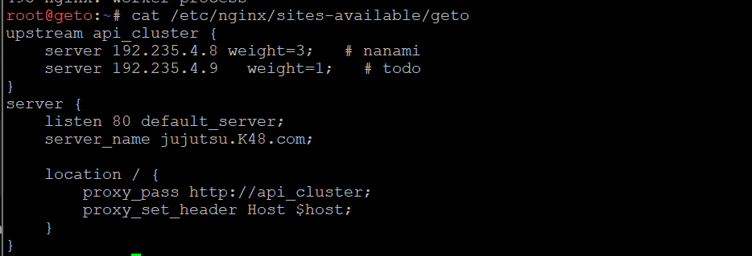
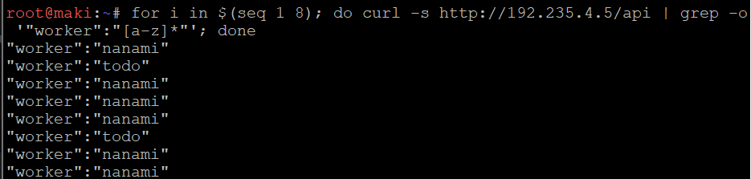
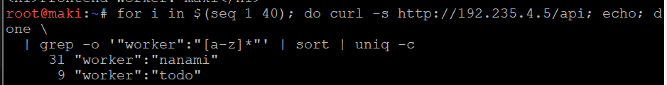
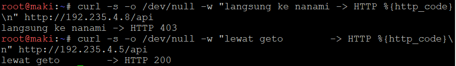

---

## 📦 Soal 16: Reverse Proxy gojo (Path-Based Routing)

### Soal 16: Penyampaian Ulang

> Gojo berdiri di perbatasan DMZ sebagai gerbang publik tunggal bagi seluruh client dari luar maupun dalam. Konfigurasikan Nginx pada gojo untuk melayani domain jujutsu.K48.com dan www.jujutsu.K48.com menggunakan metode Path-Based Routing. Atur agar request root (/) diteruskan secara Round Robin ke worker frontend (maki dan panda), sedangkan request ke path /api diteruskan langsung ke geto. Uji dari client Divisi A atau B bahwa akses ke web utama dibalas oleh Maki/Panda, sedangkan akses ke /api diteruskan dan dijawab oleh Nanami/Todo.

### 🎯 Maksud dari Soal No. 16

Klien tidak boleh tahu atau mengakses worker di Data Center secara langsung. Gojo menjadi **satu pintu masuk publik** yang meneruskan request ke tempat yang tepat, seperti resepsionis yang mengarahkan tamu.

1. **Reverse proxy:** server yang menerima request dari klien lalu meneruskannya ke server lain di belakangnya. Berbeda dengan proxy biasa, klien tidak tahu server di belakangnya.
2. **Path-based routing:** tujuan ditentukan oleh awalan URL. Path `/` menuju worker frontend, dan path `/api` menuju geto.
3. **Round Robin untuk frontend:** maki dan panda mendapat request bergantian dengan bobot sama.
4. **Dua nama domain:** `jujutsu.K48.com` dan `www.jujutsu.K48.com` dilayani oleh blok `server` yang sama.
5. **Header `Host`:** diteruskan supaya worker tahu nama domain yang diminta klien.

Soal ini juga dikerjakan bertahap. Versi akhir gojo yang menggabungkan soal 16, 17, dan 19 ada pada `/root/soal19_gojo.sh`.

### 🛠️ Cara Mengerjakan

1. Pastikan maki, panda, dan geto sudah berjalan (soal 14 dan 15).
2. Di gojo, pasang nginx dan buat `sites-available/gojo` yang berisi upstream `frontend_cluster` (maki dan panda) dan dua `location`.
3. Aktifkan situs, lalu `nginx -t` dan restart nginx.
4. Uji dari gojo sendiri, lalu dari klien (kusakabe).

#### Konfigurasi gojo (tahap ini)

```nginx
upstream frontend_cluster {
    server 192.235.4.6;     # maki
    server 192.235.4.7;     # panda
}
server {
    listen 80 default_server;
    server_name jujutsu.K48.com www.jujutsu.K48.com;

    # /api -> internal load balancer (geto)
    location /api {
        proxy_pass http://192.235.4.5;
        proxy_set_header Host $host;
    }

    # selain itu -> worker frontend (Round Robin)
    location / {
        proxy_pass http://frontend_cluster;
        proxy_set_header Host $host;
    }
}
```

> Versi akhir gojo (soal 16, 17, dan 19) ada di `/root/soal19_gojo.sh` (lihat Soal 19).

#### Penjelasan baris penting

| Baris | Fungsi |
| --- | --- |
| `upstream frontend_cluster` | Kelompok worker frontend (Round Robin bawaan nginx) |
| `server_name ... www...` | Melayani domain utama dan `www` |
| `location /api { proxy_pass http://192.235.4.5; }` | Request berawalan `/api` diteruskan ke geto |
| `location / { proxy_pass http://frontend_cluster; }` | Selain itu diteruskan ke maki/panda |
| `proxy_set_header Host $host;` | Nama domain asli ikut diteruskan |

nginx memilih `location` dengan awalan paling spesifik, jadi `/api` selalu menang atas `/`.

### ✅ Cara Melakukan Validasi

```bash
# di gojo
curl -s -H "Host: jujutsu.K48.com" http://127.0.0.1/api; echo
cat /etc/nginx/sites-available/gojo

# dari kusakabe (Divisi B)
for i in $(seq 1 6); do curl -s http://jujutsu.K48.com/; done
for i in $(seq 1 4); do curl -s http://www.jujutsu.K48.com/; done
for i in $(seq 1 8); do curl -s http://jujutsu.K48.com/api; echo; done
curl -s -o /dev/null -w "maki langsung -> HTTP %{http_code}\n" http://192.235.4.6/
curl -s -o /dev/null -w "nanami langsung -> HTTP %{http_code}\n" http://192.235.4.8/api
```

#### Hasil

Dari gojo sendiri, `/api` diteruskan ke geto dan dijawab worker API:

```text
{"worker":"todo","client_ip":"192.235.4.5","status":"ok"}
```

Halaman utama dijawab maki dan panda secara bergantian, baik lewat domain utama maupun `www`:

```text
Frontend Worker: maki / maki / panda / maki / panda / maki      (jujutsu.K48.com)
Frontend Worker: panda / maki / panda / maki                    (www.jujutsu.K48.com)
```

Path `/api` diteruskan ke geto dan dijawab nanami dan todo dengan rasio 3:1 (6 nanami, 2 todo dari 8 request). Pada tahap ini `client_ip` masih berisi IP geto (`192.235.4.5`), dan inilah yang diperbaiki di soal 17:

```text
{"worker":"nanami","client_ip":"192.235.4.5","status":"ok"}   (x3, lalu todo, dst.)
```

Akses langsung ke worker tetap ditolak, sedangkan lewat gojo berhasil:

```text
maki langsung -> HTTP 403
nanami langsung -> HTTP 403
```

**Mengapa ini membuktikan soal terpenuhi:** respons `/` datang dari maki dan panda, sedangkan `/api` dijawab nanami dan todo. Itu membuktikan routing berdasarkan path berjalan. Kedua nama domain (utama dan `www`) berfungsi. Urutan maki dan panda tidak selalu selang-seling kaku karena tiap proses nginx menghitung giliran sendiri, tetapi pembagiannya tetap merata. `client_ip` yang masih IP geto pada tahap ini adalah kondisi awal yang diperbaiki di soal berikutnya.

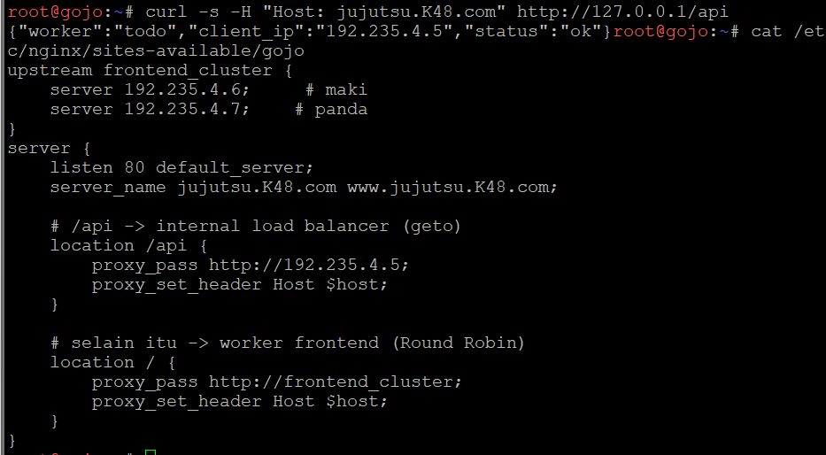
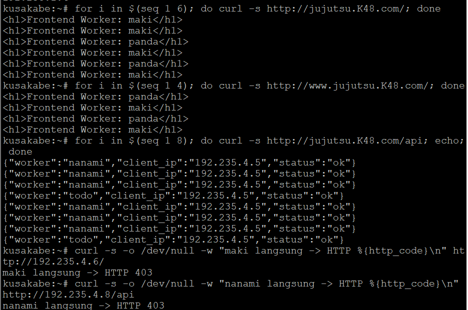

---

## 📦 Soal 17: Meneruskan IP Asli Klien

### Soal 17: Penyampaian Ulang

> Komando pusat perlu mengetahui IP asli klien yang mengirimkan request tanpa tertukar dengan IP proxy perantara. Konfigurasikan gojo dan geto agar meneruskan informasi alamat klien melalui header X-Real-IP dan X-Forwarded-For. Pastikan geto hanya mempercayai informasi alamat klien yang diterima dari proxy terpercaya, dan skrip API menyimpan alamat klien yang telah diverifikasi ke kolom client_ip pada tabel request_logs di database yaga. Uji dengan mengirimkan request dari klien Network 2 dan Network 3 ke endpoint /api, kemudian periksa database untuk memastikan alamat yang tercatat sesuai dengan IP klien asal, bukan IP gojo atau geto.

### 🎯 Maksud dari Soal No. 17

Request klien melewati rantai: **klien → gojo → geto → worker**. Dari sudut pandang worker, yang terlihat sebagai pengirim hanyalah proxy terakhir (geto). Akibatnya log hanya mencatat IP geto, bukan IP klien yang sebenarnya (kondisi di akhir soal 16). Soal ini memastikan IP klien asli tercatat.

1. **`X-Real-IP` dan `X-Forwarded-For`:** header HTTP yang dipakai proxy untuk membawa alamat klien asal ke server berikutnya.
2. **Jangan percaya header begitu saja.** Siapa pun bisa menulis `X-Real-IP: 9.9.9.9` di request. Kalau dipercaya, catatan bisa dipalsukan.
3. **Gojo (proxy terluar):** klien tidak dipercaya, jadi header **ditimpa** dengan IP koneksi sebenarnya (`$remote_addr`). Header palsu dari klien tidak ikut diteruskan.
4. **Geto:** hanya mempercayai header kalau koneksi berasal dari **gojo** (`set_real_ip_from 192.235.1.4`). Kalau berasal dari sumber lain, header diabaikan.
5. **Worker API:** hanya mempercayai `X-Real-IP` kalau koneksinya dari geto, lalu menyimpannya ke `client_ip` di database. Rantai kepercayaan ini membuat tiap pihak hanya percaya pada pihak yang satu langkah di depannya.

### 🛠️ Cara Mengerjakan

1. **Gojo:** tambahkan dua baris `proxy_set_header` di `location /api` dan `location /`.
2. **Geto:** tambahkan `set_real_ip_from 192.235.1.4;` dan `real_ip_header X-Real-IP;`, lalu teruskan `X-Real-IP` dan `X-Forwarded-For` memakai `$remote_addr` yang sudah terverifikasi.
3. **Worker API:** sudah memuat logika pengecekan sejak soal 14, jadi tidak perlu diubah.
4. Reload nginx di gojo dan geto (versi akhir sudah tercakup di `soal18_geto.sh` dan `soal19_gojo.sh`).
5. Kosongkan tabel di yaga, kirim request dari klien Network 2 dan 3, lalu cek database.
6. Uji pemalsuan header.

#### Tambahan pada gojo (di dalam `location /api` dan `location /`)

```nginx
proxy_set_header X-Real-IP $remote_addr;
proxy_set_header X-Forwarded-For $remote_addr;
```

#### Tambahan pada geto (di dalam blok `server`)

```nginx
set_real_ip_from 192.235.1.4;     # hanya gojo yang dipercaya
real_ip_header   X-Real-IP;

location / {
    proxy_pass http://api_cluster;
    proxy_set_header Host $host;
    proxy_set_header X-Real-IP $remote_addr;       # sudah terverifikasi
    proxy_set_header X-Forwarded-For $remote_addr;
}
```

#### Penjelasan baris penting

| Baris | Fungsi |
| --- | --- |
| `proxy_set_header X-Real-IP $remote_addr;` (gojo) | Menulis IP koneksi sebenarnya, menimpa header buatan klien |
| `set_real_ip_from 192.235.1.4;` (geto) | Hanya koneksi dari gojo yang boleh memberi tahu IP klien |
| `real_ip_header X-Real-IP;` (geto) | Header mana yang dibaca untuk mengganti `$remote_addr` |
| `proxy_set_header X-Real-IP $remote_addr;` (geto) | Meneruskan IP yang sudah terverifikasi ke worker |
| `in_array($remote, $trusted_proxy)` (PHP) | Worker hanya percaya header kalau pengirimnya geto |

### ✅ Cara Melakukan Validasi

```bash
# di gojo dan geto
cat /etc/nginx/sites-available/gojo
cat /etc/nginx/sites-available/geto

# di yaga: kosongkan tabel dulu
mariadb -e "DELETE FROM db_shibuya_K48.request_logs;"

# di itadori (Network 2) dan kusakabe (Network 3)
ip -br a show eth0
for i in 1 2 3 4; do curl -s http://jujutsu.K48.com/api; echo; done

# di kusakabe: uji pemalsuan header
curl -s -H "X-Real-IP: 9.9.9.9" -H "X-Forwarded-For: 9.9.9.9" http://jujutsu.K48.com/api; echo
curl -s -H "X-Real-IP: 9.9.9.9" -H "X-Forwarded-For: 9.9.9.9" http://192.235.4.5/api; echo

# di yaga
mariadb -e "SELECT id,hostname,client_ip,path FROM db_shibuya_K48.request_logs ORDER BY id;"
mariadb -e "SELECT client_ip, COUNT(*) AS jumlah FROM db_shibuya_K48.request_logs GROUP BY client_ip;"
mariadb -e "SELECT COUNT(*) AS spoofed FROM db_shibuya_K48.request_logs WHERE client_ip='9.9.9.9';"
```

#### Hasil

Konfigurasi gojo meneruskan header dengan `$remote_addr` di kedua location, dan geto hanya mempercayai `192.235.1.4` (gojo).

Dari itadori (`192.235.2.10`) dan kusakabe (`192.235.3.10`), `client_ip` sama dengan IP klien asal, bukan IP gojo atau geto:

```text
itadori:~#  {"worker":"nanami","client_ip":"192.235.2.10","status":"ok"}   (x4)
kusakabe:~# {"worker":"nanami","client_ip":"192.235.3.10","status":"ok"}
            {"worker":"todo","client_ip":"192.235.3.10","status":"ok"}
            {"worker":"nanami","client_ip":"192.235.3.10","status":"ok"}   (x2)
```

Uji pemalsuan header: kedua-duanya tetap mengembalikan IP kusakabe yang asli. Lewat gojo, header palsu ditimpa. Langsung ke geto dari klien, header diabaikan karena sumbernya bukan gojo:

```text
{"worker":"nanami","client_ip":"192.235.3.10","status":"ok"}
{"worker":"todo","client_ip":"192.235.3.10","status":"ok"}
```

Isi database di yaga:

```text
| id  | hostname | client_ip    | path |
| 111 | nanami   | 192.235.2.10 | /api |
| 112 | nanami   | 192.235.2.10 | /api |
| 113 | nanami   | 192.235.2.10 | /api |
| 114 | nanami   | 192.235.2.10 | /api |
| 115 | nanami   | 192.235.3.10 | /api |
| 116 | todo     | 192.235.3.10 | /api |
| 117 | nanami   | 192.235.3.10 | /api |
| 118 | nanami   | 192.235.3.10 | /api |

| client_ip    | jumlah |        spoofed = 0
| 192.235.2.10 |      4 |
| 192.235.3.10 |      4 |
```

**Mengapa ini membuktikan soal terpenuhi:** database hanya berisi IP klien asli dari Network 2 dan 3, tidak ada IP gojo (`192.235.1.4`) maupun geto (`192.235.4.5`). Uji pemalsuan menghasilkan `spoofed = 0`, yang membuktikan header palsu tidak bisa menembus rantai kepercayaan, baik lewat gojo (ditimpa) maupun langsung ke geto (diabaikan).

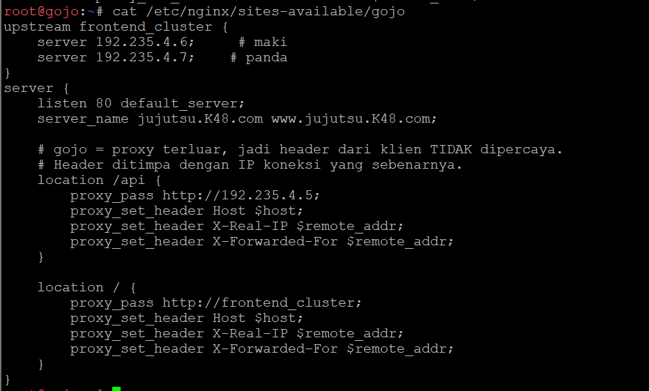
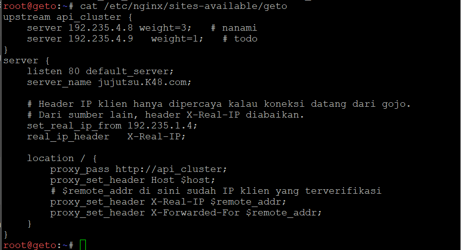
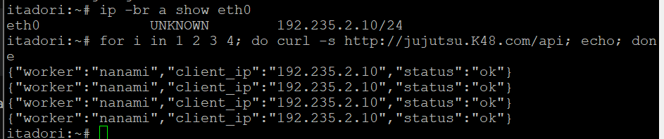
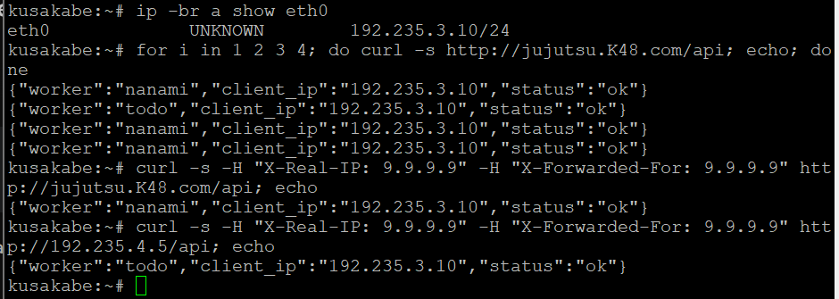
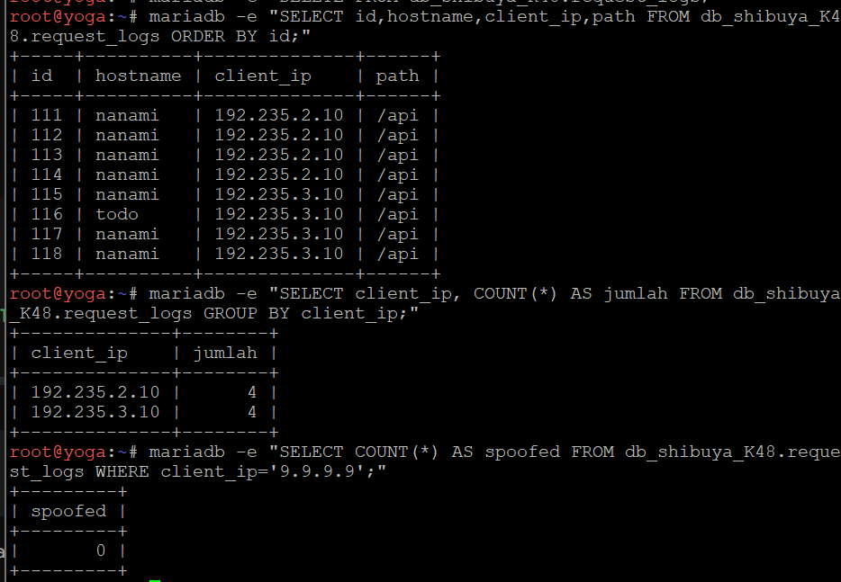

---

## 📦 Soal 18: Server Backup (kirara) dan Passive Health Check

### Soal 18: Penyampaian Ulang

> nanami dan todo merupakan worker API utama, sedangkan kirara disiapkan sebagai worker cadangan. Konfigurasikan upstream api_cluster pada geto agar kirara menjadi server backup, serta terapkan passive health check dengan parameter max_fails=2 dan fail_timeout=5s pada worker API utama. Pastikan kirara menjalankan layanan API yang kompatibel dengan endpoint utama. Simulasikan gangguan dengan menghentikan layanan Nginx atau layanan API pada nanami dan todo. Buktikan dari klien bahwa request ke /api dialihkan ke kirara dan menghasilkan respons API yang valid tanpa error 502 Bad Gateway.

### 🎯 Maksud dari Soal No. 18

Soal 15 membagi beban, tetapi belum menjawab pertanyaan: bagaimana kalau worker mati? Soal ini membuat sistem tetap melayani walau worker utama gagal.

1. **Server `backup`:** kirara tidak ikut menerima request dalam keadaan normal. Ia hanya dipakai kalau **semua** server utama (nanami dan todo) tidak tersedia.
2. **Passive health check:** nginx tidak memeriksa kesehatan server secara berkala. Ia menilai dari request nyata. `max_fails=2 fail_timeout=5s` berarti: kalau sebuah server gagal 2 kali dalam 5 detik, server itu dianggap mati selama 5 detik dan tidak dikirimi request.
3. **`proxy_next_upstream`:** kalau satu server gagal, nginx mencoba server berikutnya **pada request yang sama**. Karena itu klien tidak melihat error, hanya menerima jawaban dari server yang sehat.
4. **`proxy_connect_timeout 2s`:** mempercepat deteksi server yang tidak merespons, supaya klien tidak menunggu lama.
5. **Kompatibilitas:** kirara memakai skrip API yang sama persis (`soal14_api.sh`), jadi responsnya sama bentuknya dengan nanami dan todo.

### 🛠️ Cara Mengerjakan

1. Pastikan kirara sudah menjalankan `soal14_api.sh` dan bisa menerima trafik dari geto.
2. Di geto, jalankan skrip final `soal18_geto.sh`. Ia menggantikan konfigurasi sebelumnya dengan versi lengkap (bobot, health check, backup, real IP, dan log upstream).
3. Uji kondisi normal: kirara tidak boleh muncul.
4. Simulasikan gangguan: hentikan nginx di nanami dan todo, lalu kirim request dari klien.
5. Periksa log geto dan database.
6. Pulihkan nanami dan todo, lalu cek distribusi kembali normal.

#### Konfigurasi geto (versi akhir, soal 15, 17, 18) — `/root/soal18_geto.sh`

```bash
#!/bin/bash
GOJO_IP=192.235.1.4
NANAMI_IP=192.235.4.8
TODO_IP=192.235.4.9
KIRARA_IP=192.235.4.2

echo "nameserver 192.168.122.1" > /etc/resolv.conf
apt-get update && apt-get install -y nginx curl

# format log: menunjukkan upstream yang dicoba tiap request
cat > /etc/nginx/conf.d/geto-log.conf <<'EOF'
log_format geto_log '$remote_addr [$time_local] "$request" status=$status ua=$upstream_addr us=$upstream_status rt=$request_time';
EOF

cat > /etc/nginx/sites-available/geto <<'EOF'
upstream api_cluster {
    server __NANAMI_IP__ weight=3 max_fails=2 fail_timeout=5s;   # nanami
    server __TODO_IP__   weight=1 max_fails=2 fail_timeout=5s;   # todo
    server __KIRARA_IP__ backup;                                 # kirara
}
server {
    listen 80 default_server;
    server_name jujutsu.K48.com;
    access_log /var/log/nginx/geto_access.log geto_log;

    set_real_ip_from __GOJO_IP__;
    real_ip_header   X-Real-IP;

    location / {
        proxy_pass http://api_cluster;
        proxy_set_header Host $host;
        proxy_set_header X-Real-IP $remote_addr;
        proxy_set_header X-Forwarded-For $remote_addr;

        proxy_connect_timeout 2s;
        proxy_next_upstream error timeout http_502 http_503 http_504;
    }
}
EOF
sed -i "s/__GOJO_IP__/$GOJO_IP/; s/__NANAMI_IP__/$NANAMI_IP/; s/__TODO_IP__/$TODO_IP/; s/__KIRARA_IP__/$KIRARA_IP/" /etc/nginx/sites-available/geto

rm -f /etc/nginx/sites-enabled/default
ln -sf /etc/nginx/sites-available/geto /etc/nginx/sites-enabled/geto
nginx -t && service nginx restart
```

#### Penjelasan baris penting

| Baris | Fungsi |
| --- | --- |
| `weight=3 max_fails=2 fail_timeout=5s` | Bobot 3, ditandai mati 5 detik setelah 2 kali gagal |
| `server ... backup;` | Kirara hanya dipakai kalau semua server utama mati |
| `proxy_connect_timeout 2s;` | Server yang tidak merespons cepat dianggap gagal |
| `proxy_next_upstream error timeout http_502 ...` | Request yang gagal dicoba ke server lain, klien tidak melihat error |
| `log_format geto_log ... ua=$upstream_addr us=$upstream_status` | Mencatat server mana saja yang dicoba dan kode responsnya (bukti di log) |

### ✅ Cara Melakukan Validasi

```bash
# 1. Kondisi normal (dari kusakabe): kirara tidak boleh muncul
for i in $(seq 1 8); do curl -s http://jujutsu.K48.com/api; echo; done

# 2. Simulasi gangguan: di nanami dan todo
service nginx stop
pgrep -a nginx || echo "nginx mati"

# 3. Dari kusakabe: semua respons harus dari kirara, tanpa 502
for i in $(seq 1 10); do curl -s -w "  [HTTP %{http_code}]\n" http://jujutsu.K48.com/api; done
for i in $(seq 1 20); do curl -s -o /dev/null -w "%{http_code}\n" http://jujutsu.K48.com/api; done | sort | uniq -c
for i in $(seq 1 20); do curl -s http://jujutsu.K48.com/api; echo; done | grep -o '"worker":"[a-z]*"' | sort | uniq -c

# 4. Bukti di geto
tail -8 /var/log/nginx/geto_access.log
grep "connect() failed" /var/log/nginx/error.log | tail -4

# 5. Bukti di yaga
mariadb -e "SELECT hostname, client_ip, COUNT(*) AS jumlah FROM db_shibuya_K48.request_logs GROUP BY hostname, client_ip;"

# 6. Pemulihan: di nanami dan todo
service nginx start
PHPV=$(php -r 'echo PHP_MAJOR_VERSION.".".PHP_MINOR_VERSION;')
service php${PHPV}-fpm start
curl -s http://127.0.0.1/api

# 7. Dari kusakabe, setelah 6 detik
sleep 6
for i in $(seq 1 12); do curl -s http://jujutsu.K48.com/api; echo; done | grep -o '"worker":"[a-z]*"' | sort | uniq -c
```

#### Hasil

Blok upstream geto memuat kirara sebagai `backup` dan parameter health check pada nanami dan todo:

```text
upstream api_cluster {
    server 192.235.4.8 weight=3 max_fails=2 fail_timeout=5s;   # nanami
    server 192.235.4.9 weight=1 max_fails=2 fail_timeout=5s;   # todo
    server 192.235.4.2 backup;                                 # kirara
}
```

Pada kondisi normal, request hanya dilayani nanami dan todo (7 nanami, 1 todo dari 8 request), dan kirara tidak muncul.

Saat nginx di nanami dan todo dimatikan (`pgrep` mencetak `nginx mati`), semua respons berasal dari kirara dengan HTTP 200 dan **tidak ada 502**:

```text
{"worker":"kirara","client_ip":"192.235.3.10","status":"ok"}  [HTTP 200]   (x10)

kusakabe:~# ... | sort | uniq -c
     20 200
kusakabe:~# ... | grep -o '"worker":"[a-z]*"' | sort | uniq -c
     20 "worker":"kirara"
```

Log geto menunjukkan request pertama dicoba ke nanami dan todo (kode 502), lalu berhasil di kirara (kode 200). Request berikutnya langsung ke kirara karena nanami dan todo sudah ditandai mati (efek `max_fails=2`). Klien selalu menerima `status=200`:

```text
192.235.3.10 [14/Oct/2026:16:09:54 +0000] "GET /api HTTP/1.0" status=200 ua=192.235.4.8:80, 192.235.4.9:80, 192.235.4.2:80 us=502, 502, 200 rt=0.003
192.235.3.10 [14/Oct/2026:16:09:54 +0000] "GET /api HTTP/1.0" status=200 ua=192.235.4.9:80, 192.235.4.8:80, 192.235.4.2:80 us=502, 502, 200 rt=0.003
192.235.3.10 [14/Oct/2026:16:09:54 +0000] "GET /api HTTP/1.0" status=200 ua=192.235.4.2:80 us=200 rt=0.003
192.235.3.10 [14/Oct/2026:16:09:54 +0000] "GET /api HTTP/1.0" status=200 ua=192.235.4.2:80 us=200 rt=0.002
```

`error.log` mencatat penyebab kegagalan nanami dan todo:

```text
connect() failed (111: Connection refused) while connecting to upstream, ... upstream: "http://192.235.4.8:80/api"
connect() failed (111: Connection refused) while connecting to upstream, ... upstream: "http://192.235.4.9:80/api"
```

Isi database di yaga:

```text
| hostname | client_ip    | jumlah |
| kirara   | 192.235.3.10 |     50 |
| nanami   | 192.235.3.10 |      7 |
| todo     | 192.235.3.10 |      1 |
```

Angka ini sesuai urutan pengujian. Nanami (7) dan todo (1) berasal dari 8 request pada kondisi normal sebelum gangguan. Kirara (50) berasal dari 10 + 20 + 20 request selama nanami dan todo mati. Tidak ada request saat gangguan yang jatuh ke nanami atau todo, dan tidak ada `502` yang sampai ke klien.

**Pemulihan.** Nginx dan PHP-FPM di nanami dan todo dinyalakan kembali, dan `curl` lokal menunjukkan `"status":"ok"`:

```text
root@nanomi:~# pgrep -a nginx || echo "nginx mati"
nginx mati
root@nanomi:~# service nginx start
Starting nginx: nginx.
root@nanomi:~# service php${PHPV}-fpm start
root@nanomi:~# curl -s http://127.0.0.1/api
{"worker":"nanami","client_ip":"127.0.0.1","status":"ok"}
root@todo:~# curl -s http://127.0.0.1/api
{"worker":"todo","client_ip":"127.0.0.1","status":"ok"}
```

Setelah `fail_timeout` terlewati, nanami dan todo kembali melayani dengan rasio 3:1 dan kirara tidak muncul lagi:

```text
kusakabe:~# ... | sort | uniq -c
      9 "worker":"nanami"
      3 "worker":"todo"
```

**Mengapa ini membuktikan soal terpenuhi:**

- Semua respons saat gangguan adalah `200` dari kirara, jadi tidak ada `502 Bad Gateway` ke klien.
- Kolom `us=502, 502, 200` di log geto menunjukkan nginx mencoba nanami dan todo dulu, lalu pindah ke kirara dalam satu request. Itu perilaku `proxy_next_upstream`.
- Request berikutnya langsung ke kirara tanpa mencoba lagi nanami dan todo, yang menunjukkan `max_fails=2` dan `fail_timeout=5s` bekerja.
- Setelah dipulihkan, rasio 9:3 menunjukkan nanami dan todo kembali melayani dan kirara kembali menjadi cadangan.

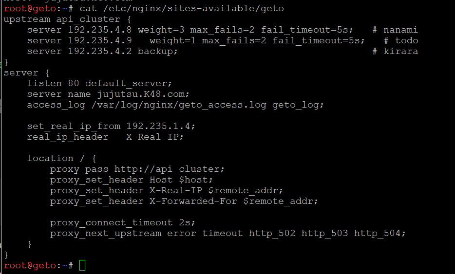
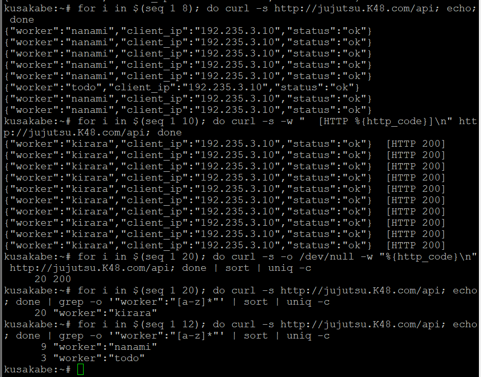
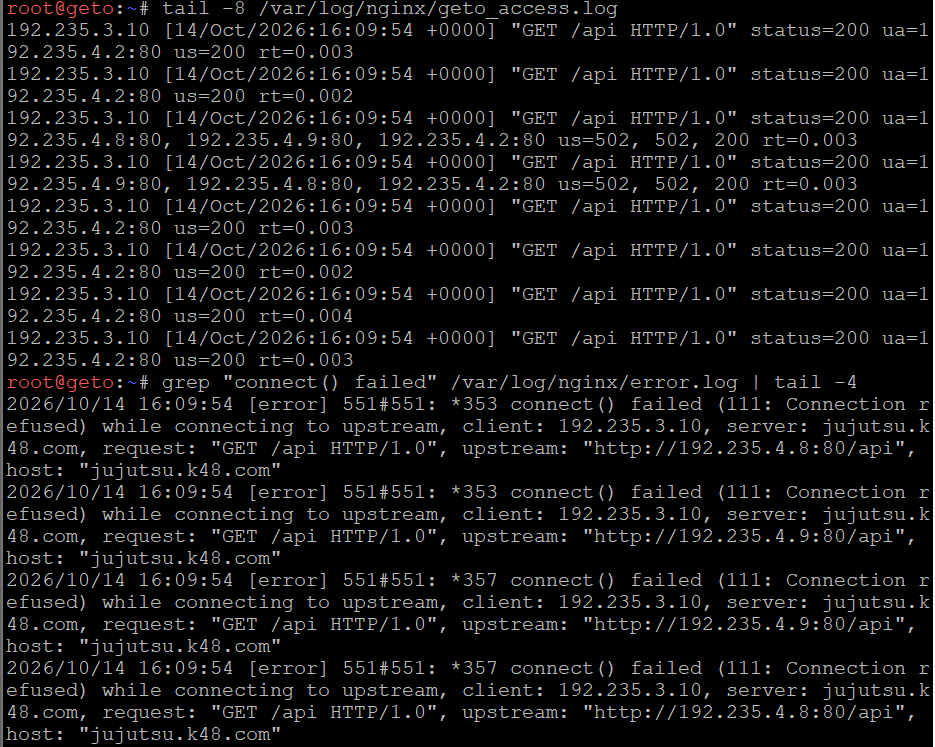
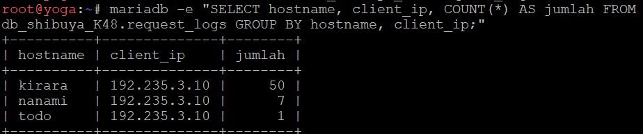
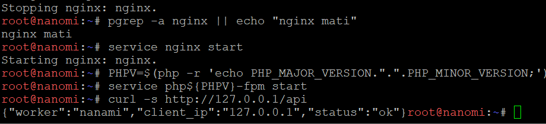
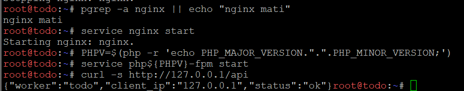

---

## 📦 Soal 19: Proxy Caching dan Rate Limiting di gojo

### Soal 19: Penyampaian Ulang

> gojo bertugas mengoptimalkan layanan web sekaligus membatasi request berlebihan. Konfigurasikan Nginx Proxy Caching untuk halaman web frontend dengan masa berlaku cache 10 menit dan tambahkan header X-Cache-Status. Terapkan rate limiting pada path /api dengan batas 10 request per detik per IP klien. Buktikan bahwa request ke halaman web yang memenuhi syarat cache menghasilkan status MISS pada akses awal dan HIT pada akses berikutnya. Uji rate limiting secara terpisah dengan mengirimkan request beruntun ke /api, kemudian catat status respons yang dihasilkan ketika batas terlampaui.

### 🎯 Maksud dari Soal No. 19

Gojo menjadi pintu semua klien, sehingga ia juga tempat terbaik untuk meringankan beban dan melindungi backend. Ada dua fitur terpisah:

1. **Proxy cache (untuk halaman web `/`):** jawaban dari maki atau panda disimpan di gojo selama 10 menit. Request pertama harus bertanya ke worker (**MISS**). Request berikutnya langsung dijawab dari cache gojo (**HIT**) tanpa membebani worker.
2. **Header `X-Cache-Status`:** menampilkan apakah jawaban berasal dari cache (`HIT`) atau dari worker (`MISS`). Header ini menjadi bukti yang bisa dilihat klien.
3. **Rate limiting (untuk `/api`):** membatasi satu IP klien hanya 10 request per detik. Kelebihannya ditolak gojo dengan kode **429 Too Many Requests** sebelum sampai ke geto, sehingga backend terlindungi dari banjir request.
4. **Pembagian tugas:** `/` hanya di-cache dan tidak dibatasi, sedangkan `/api` hanya dibatasi dan tidak di-cache. Data API selalu berubah dan menulis ke database, jadi memang tidak boleh di-cache.
5. **Tanpa `burst`:** batas dibiarkan ketat. Request yang datang lebih cepat dari 1 per 100 ms langsung ditolak, sehingga efeknya mudah dilihat di pengujian.

Soal ini menggantikan konfigurasi gojo sebelumnya dengan versi akhir yang tetap memuat routing (soal 16) dan header IP klien (soal 17).

### 🛠️ Cara Mengerjakan

1. Siapkan folder cache `/var/cache/nginx/frontend` dan beri izin ke `www-data`.
2. Buat `conf.d/gojo-global.conf` berisi zona cache, zona rate limit, dan format log.
3. Perbarui `sites-available/gojo`: `location /api` diberi `limit_req`, dan `location /` diberi `proxy_cache` serta header `X-Cache-Status`.
4. Jalankan `nginx -t` lalu restart nginx. Seluruh langkah ini sudah tercakup di `/root/soal19_gojo.sh`.
5. Uji cache dengan `curl` berulang dan lihat header.
6. Uji rate limit dengan loop request beruntun ke `/api`.

#### Konfigurasi gojo (versi akhir, soal 16, 17, 19) — `/root/soal19_gojo.sh`

```bash
#!/bin/bash
MAKI_IP=192.235.4.6
PANDA_IP=192.235.4.7
GETO_IP=192.235.4.5

echo "nameserver 192.168.122.1" > /etc/resolv.conf
apt-get update && apt-get install -y nginx curl

mkdir -p /var/cache/nginx/frontend
chown -R www-data:www-data /var/cache/nginx

# zona cache, zona rate limit, dan format log (level http)
cat > /etc/nginx/conf.d/gojo-global.conf <<'EOF'
proxy_cache_path /var/cache/nginx/frontend levels=1:2 keys_zone=frontend_cache:10m max_size=100m inactive=10m use_temp_path=off;
limit_req_zone $binary_remote_addr zone=api_limit:10m rate=10r/s;
log_format gojo_log '$remote_addr [$time_local] "$request" status=$status rt=$request_time ua=$upstream_addr us=$upstream_status cache=$upstream_cache_status';
EOF

cat > /etc/nginx/sites-available/gojo <<'EOF'
upstream frontend_cluster {
    server __MAKI_IP__;     # maki
    server __PANDA_IP__;    # panda
}
server {
    listen 80 default_server;
    server_name jujutsu.K48.com www.jujutsu.K48.com;
    access_log /var/log/nginx/gojo_access.log gojo_log;

    # API: rate limit 10 r/s per IP klien, tanpa cache
    location /api {
        limit_req zone=api_limit;
        limit_req_status 429;
        proxy_pass http://__GETO_IP__;
        proxy_set_header Host $host;
        proxy_set_header X-Real-IP $remote_addr;
        proxy_set_header X-Forwarded-For $remote_addr;
    }

    # Web frontend: proxy cache 10 menit
    location / {
        proxy_pass http://frontend_cluster;
        proxy_set_header Host $host;
        proxy_set_header X-Real-IP $remote_addr;
        proxy_set_header X-Forwarded-For $remote_addr;

        proxy_cache frontend_cache;
        proxy_cache_valid 200 10m;
        proxy_cache_key "$scheme$host$request_uri";
        add_header X-Cache-Status $upstream_cache_status always;
    }
}
EOF
sed -i "s/__MAKI_IP__/$MAKI_IP/; s/__PANDA_IP__/$PANDA_IP/; s/__GETO_IP__/$GETO_IP/" /etc/nginx/sites-available/gojo

rm -f /etc/nginx/sites-enabled/default
ln -sf /etc/nginx/sites-available/gojo /etc/nginx/sites-enabled/gojo
nginx -t && service nginx restart
```

#### Penjelasan baris penting

| Baris | Fungsi |
| --- | --- |
| `proxy_cache_path ... keys_zone=frontend_cache:10m` | Lokasi file cache dan zona memori untuk indeksnya |
| `proxy_cache_valid 200 10m;` | Jawaban berstatus 200 disimpan selama 10 menit |
| `proxy_cache_key "$scheme$host$request_uri"` | Dua request dianggap sama kalau skema, host, dan URI sama |
| `add_header X-Cache-Status $upstream_cache_status always;` | Menampilkan `MISS` atau `HIT` pada respons |
| `limit_req_zone $binary_remote_addr ... rate=10r/s` | Menghitung request per IP klien, batas 10 per detik |
| `limit_req zone=api_limit;` | Menerapkan batas hanya pada `/api` |
| `limit_req_status 429;` | Kode untuk request yang melebihi batas |
| `log_format gojo_log ... cache=$upstream_cache_status` | Log mencatat status cache, upstream, dan kode respons |

### ✅ Cara Melakukan Validasi

```bash
# di gojo
cat /etc/nginx/conf.d/gojo-global.conf
cat /etc/nginx/sites-available/gojo

# dari kusakabe: cache MISS lalu HIT
curl -s -D - -o /dev/null http://jujutsu.K48.com/ | grep -i x-cache-status
curl -s -D - -o /dev/null http://jujutsu.K48.com/ | grep -i x-cache-status
curl -s -D - -o /dev/null http://jujutsu.K48.com/ | grep -i x-cache-status

# di gojo: bukti file cache
ls -R /var/cache/nginx/frontend | head

# dari kusakabe: rate limit pada /api
for i in $(seq 1 30); do curl -s -o /dev/null -w "%{http_code}\n" http://jujutsu.K48.com/api; done | sort | uniq -c

# di gojo
grep "status=429" /var/log/nginx/gojo_access.log | head -3
grep "limiting requests" /var/log/nginx/error.log | tail -3
```

#### Hasil

Konfigurasi global (`gojo-global.conf`) memuat zona cache `frontend_cache` (10 MB, `inactive=10m`), zona rate limit `api_limit` (`10r/s`), dan format log `gojo_log`. Konfigurasi gojo memakai `limit_req zone=api_limit` pada `/api` dan `proxy_cache frontend_cache` pada `/`.

Status cache berubah dari `MISS` ke `HIT` pada akses berikutnya:

```text
kusakabe:~# curl -s -D - -o /dev/null http://jujutsu.K48.com/ | grep -i x-cache-status
X-Cache-Status: MISS
kusakabe:~# curl -s -D - -o /dev/null http://jujutsu.K48.com/ | grep -i x-cache-status
X-Cache-Status: HIT
kusakabe:~# curl -s -D - -o /dev/null http://jujutsu.K48.com/ | grep -i x-cache-status
X-Cache-Status: HIT
```

File cache tersimpan di gojo:

```text
root@gojo:~# ls -R /var/cache/nginx/frontend | head
/var/cache/nginx/frontend:
c
d

/var/cache/nginx/frontend/c:
4f

/var/cache/nginx/frontend/c/4f:
4a35b3d664ad1405fb1543d21012e4fc
```

Rate limit pada `/api`: dari 30 request beruntun hanya 2 yang lolos dan 28 ditolak:

```text
kusakabe:~# for i in $(seq 1 30); do ... done | sort | uniq -c
      2 200
     28 429
```

Request yang ditolak punya `ua=-` dan `us=-` (ditolak gojo sebelum diteruskan ke geto), dan `error.log` mencatat pelanggaran zona `api_limit`:

```text
192.235.3.10 [14/Oct/2026:16:26:59 +0000] "GET /api HTTP/1.1" status=429 rt=0.000 ua=- us=- cache=-
2026/10/14 16:26:59 [error] 564#564: *39 limiting requests, excess: 0.440 by zone "api_limit", client: 192.235.3.10, server: jujutsu.K48.com, request: "GET /api HTTP/1.1", host: "jujutsu.K48.com"
2026/10/14 16:26:59 [error] 564#564: *40 limiting requests, excess: 0.390 by zone "api_limit", client: 192.235.3.10, ...
2026/10/14 16:26:59 [error] 563#563: *41 limiting requests, excess: 0.340 by zone "api_limit", client: 192.235.3.10, ...
```

**Mengapa ini membuktikan soal terpenuhi:**

- `MISS` pada akses pertama lalu `HIT` pada akses kedua dan ketiga membuktikan jawaban halaman web disimpan dan disajikan ulang dari cache gojo. File cache terlihat di `/var/cache/nginx/frontend`.
- 28 dari 30 request `/api` mendapat `429` membuktikan batas 10 request per detik diterapkan. Baris `ua=-` menunjukkan request ditolak di gojo dan tidak pernah sampai ke geto atau database.
- Pesan "limiting requests ... zone api_limit" di `error.log` menjadi catatan resmi nginx bahwa penolakan itu berasal dari kebijakan rate limit.

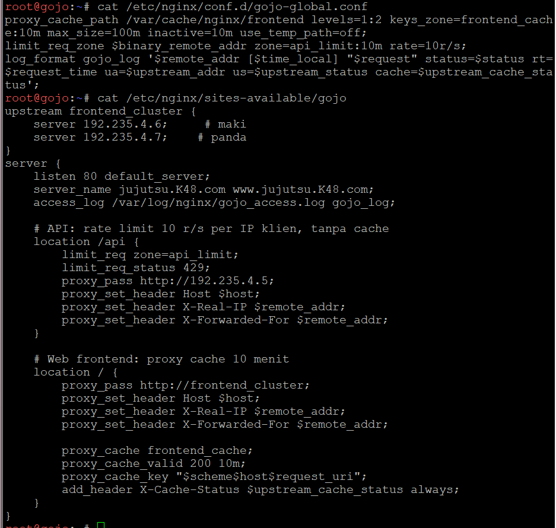
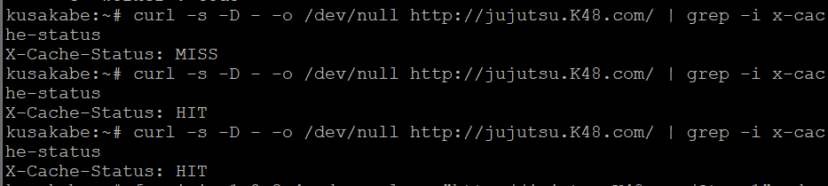
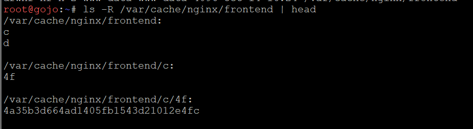
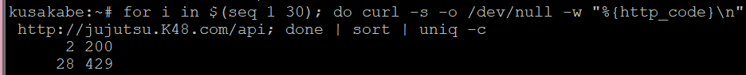
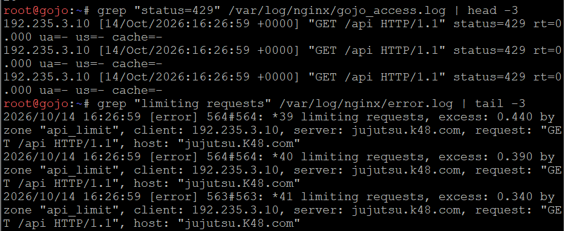

---

## 📦 Soal 20: Benchmark ApacheBench dan Analisis

### Soal 20: Penyampaian Ulang

> Sebelum Curtain di Shibuya resmi dibuka, Kusakabe memimpin audit untuk menguji kapasitas layanan. Dari terminal kusakabe, jalankan benchmark menggunakan Apache Benchmark dengan parameter -n 600 -c 30 menuju http://jujutsu.K48.com/. Catat Requests per Second (RPS), latensi, dan jumlah request yang gagal. Lakukan pengujian tambahan pada endpoint /api untuk mengamati efek rate limiting. Bandingkan hasil pengujian baseline dengan hasil ketika rate limiting aktif, serta gunakan access log gojo untuk membedakan kegagalan aplikasi, koneksi, dan request yang ditolak oleh kebijakan rate limit.

### 🎯 Maksud dari Soal No. 20

Soal terakhir menguji seluruh rancangan sekaligus: seberapa banyak request yang sanggup dilayani, dan apa yang terjadi saat sistem dibanjiri. Alatnya **ApacheBench (`ab`)**.

1. **`-n 600 -c 30`:** kirim total 600 request dengan 30 request berjalan bersamaan.
2. **Metrik yang dicatat:**
   - **RPS (Requests per Second):** seberapa banyak request selesai per detik. Makin tinggi makin cepat.
   - **Latensi:** waktu per request (rata-rata dan persentil, misalnya p95 berarti 95% request selesai dalam waktu itu).
   - **Failed requests:** jumlah request yang dianggap gagal oleh `ab`.
3. **Tiga skenario pembanding:** halaman `/` (dengan cache), `/api` **baseline** (rate limit dimatikan sementara), dan `/api` dengan rate limit aktif. Hasil baseline menjadi tolok ukur untuk melihat efek rate limiting.
4. **Opsi `-l`:** tanpa opsi ini, `ab` menganggap respons yang panjangnya berbeda sebagai gagal (tipe *Length*). Respons API memang berbeda panjang (nama `nanami` dan `kirara` 6 huruf, `todo` 4 huruf, dan halaman `429` lebih panjang), sehingga angka `Failed requests` menyesatkan. Dengan `-l`, kegagalan yang sebenarnya terlihat.
5. **RPS berhasil (`RPS_OK`):** RPS mentah dari `ab` ikut menghitung respons `429` yang sangat murah, sehingga terlihat tinggi saat rate limit aktif. Angka yang adil adalah `(Complete requests − Non-2xx) / Time taken`.
6. **Membedakan jenis kegagalan lewat log gojo:** request yang ditolak kebijakan (429, `ua=-`), kegagalan aplikasi (5xx dengan alamat upstream), dan kegagalan koneksi (request tidak muncul di log) punya ciri berbeda.

### 🛠️ Cara Mengerjakan

1. **Siapkan kusakabe:** pasang `apache2-utils` (berisi `ab`), buat skrip bantu `bench.sh` dan `summary.sh`.
2. **Kosongkan data lama sebelum tiap run** (log gojo dan tabel yaga), lalu beri jeda sekitar 5 detik antar-run supaya hitungan rate limit per IP kosong.
3. **Run 1:** benchmark halaman `/` (cache aktif).
4. **Run 2 (baseline):** matikan `limit_req` di gojo sementara, jalankan benchmark `/api` tanpa dan dengan `-l`.
5. **Run 3:** aktifkan lagi `limit_req`, jalankan benchmark `/api` tanpa dan dengan `-l`.
6. **Analisis:** jalankan `summary.sh`, lihat persentil, log gojo, dan database.
7. **Pulihkan:** pastikan rate limit aktif kembali dan tabel dikosongkan.

#### Persiapan di kusakabe

```bash
apk update && apk add apache2-utils curl
```

#### Skrip bantu — `/root/bench.sh`

```sh
#!/bin/sh
# pemakaian: sh /root/bench.sh <label> <url> [opsi ab tambahan, mis. -l]
LABEL=$1; URL=$2; shift 2
ab -n 600 -c 30 "$@" "$URL" > /root/ab_$LABEL.txt 2>&1
echo "=== $LABEL ($URL) ==="
grep -E "Document Length|Time taken|Complete requests|Failed requests|Connect:|Receive:|Length:|Exceptions:|Non-2xx|Requests per second|Time per request" /root/ab_$LABEL.txt
grep -E "^ +(50|95|99|100)%" /root/ab_$LABEL.txt
```

#### Skrip ringkasan — `/root/summary.sh`

```sh
#!/bin/sh
printf "%-20s %9s %9s %9s %8s %8s %8s\n" FILE RPS RPS_OK MEAN_MS P95_MS FAILED NON2XX
for f in /root/ab_*.txt; do
  n=$(basename "$f" .txt)
  complete=$(grep "Complete requests" "$f" | awk '{print $3}')
  t=$(grep "Time taken for tests" "$f" | awk '{print $5}')
  rps=$(grep "Requests per second" "$f" | awk '{print $4}')
  mean=$(grep "Time per request" "$f" | head -1 | awk '{print $4}')
  p95=$(grep -E "^ +95%" "$f" | awk '{print $2}')
  failed=$(grep "Failed requests" "$f" | awk '{print $3}')
  non2xx=$(grep "Non-2xx" "$f" | awk '{print $3}')
  [ -z "$non2xx" ] && non2xx=0
  ok=$(awk -v c="$complete" -v n="$non2xx" -v t="$t" 'BEGIN{ if (t>0) printf "%.2f", (c-n)/t; else print "-" }')
  printf "%-20s %9s %9s %9s %8s %8s %8s\n" "$n" "$rps" "$ok" "$mean" "$p95" "$failed" "$non2xx"
done
```

#### Sebelum setiap run

```bash
# gojo
: > /var/log/nginx/gojo_access.log
: > /var/log/nginx/error.log
# yaga
mariadb -e "DELETE FROM db_shibuya_K48.request_logs;"
```

#### Run 1 — halaman `/` (cache aktif)

```bash
sh /root/bench.sh root http://jujutsu.K48.com/
```

#### Run 2 — `/api` baseline (rate limit dimatikan)

```bash
# gojo: matikan limit_req sementara
sed -i 's/^\(\s*\)limit_req zone/\1#limit_req zone/' /etc/nginx/sites-available/gojo
nginx -t && nginx -s reload

# kusakabe
sh /root/bench.sh api_baseline http://jujutsu.K48.com/api
sh /root/bench.sh api_baseline_l http://jujutsu.K48.com/api -l
```

#### Run 3 — `/api` dengan rate limit aktif

```bash
# gojo: aktifkan lagi
sed -i 's/#limit_req zone/limit_req zone/' /etc/nginx/sites-available/gojo
nginx -t && nginx -s reload

# kusakabe
sh /root/bench.sh api_ratelimit http://jujutsu.K48.com/api
sh /root/bench.sh api_ratelimit_l http://jujutsu.K48.com/api -l
```

### ✅ Cara Melakukan Validasi

1. **Ringkasan dan persentil di kusakabe:**

```bash
sh /root/summary.sh
for f in root api_baseline api_ratelimit; do
  echo "=== Percentile $f ==="
  grep -E "^ +(50|95|99|100)%" /root/ab_$f.txt
done
cat /root/ab_api_ratelimit_l.txt
```

2. **Analisis log gojo dan database setelah tiap run:**

```bash
# gojo
L=/var/log/nginx/gojo_access.log
grep -o 'status=[0-9]*' $L | sort | uniq -c
grep -c 'status=429' $L
grep -c "limiting requests" /var/log/nginx/error.log

# yaga
mariadb -e "SELECT COUNT(*) AS tersimpan FROM db_shibuya_K48.request_logs;"
mariadb -e "SELECT hostname, COUNT(*) AS jumlah FROM db_shibuya_K48.request_logs GROUP BY hostname;"
```

#### Hasil

```text
kusakabe:~# sh /root/summary.sh
FILE                       RPS    RPS_OK   MEAN_MS   P95_MS   FAILED   NON2XX
ab_api_baseline         635.78    635.59    47.186       71      145        0
ab_api_baseline_l       697.91    697.67    42.985       66        0        0
ab_api_ratelimit       4950.50     16.53     6.060        8      599      598
ab_api_ratelimit_l     4948.41     16.53     6.063        8        0      598
ab_root                6049.12   6060.61     4.959        6        0        0
```

| Skenario | Waktu tes (s) | RPS (`ab`) | RPS berhasil | Mean (ms) | p50 / p95 / p99 / max (ms) | Failed tanpa `-l` | Failed dengan `-l` | Non-2xx |
| --- | ---: | ---: | ---: | ---: | --- | ---: | ---: | ---: |
| `/` (cache gojo) | 0,099 | 6049,12 | ≈ 6049 | 4,96 | 5 / 6 / 6 / 7 | 0 | n/a | 0 |
| `/api` baseline (tanpa limit) | 0,944 (`-l`: 0,860) | 635,78 (`-l`: 697,91) | 635,59 (`-l`: 697,67) | 47,19 (`-l`: 42,99) | 53 / 71 / 75 / 77 (`-l`: 48 / 66 / 71 / 75) | 145 | 0 | 0 |
| `/api` rate limit aktif | 0,121 | 4950,50 (`-l`: 4948,41) | 16,53 | 6,06 (`-l`: 6,06) | 5 / 8 / 8 / 20 (`-l`: 5 / 8 / 11 / 19) | 599 | 0 | 598 |

`RPS berhasil` untuk `/` tampil 6060,61 di `summary.sh`. Selisih kecil dengan 6049,12 berasal dari pembulatan `Time taken` (hanya 0,099 detik), jadi angka `ab` dipakai sebagai acuan.

Detail `ab_api_ratelimit_l.txt` (`ab -n 600 -c 30 -l`):

```text
Server Software:        nginx
Document Path:          /api
Document Length:        Variable
Concurrency Level:      30
Time taken for tests:   0.121 seconds
Complete requests:      600
Failed requests:        0
Non-2xx responses:      598
Total transferred:      187538 bytes
HTML transferred:       96996 bytes
Requests per second:    4948.41 [#/sec] (mean)
Time per request:       6.063 [ms] (mean)
Time per request:       0.202 [ms] (mean, across all concurrent requests)
Transfer rate:          1510.44 [Kbytes/sec] received

Connection Times (ms)
              min  mean[+/-sd] median   max
Connect:        0    3   0.8      2       7
Processing:     1    3   1.0      3      15
Waiting:        1    3   1.0      3      15
Total:          3    6   1.5      5      19

  50%      5     66%      6     75%      6     80%      6
  90%      7     95%      8     98%     11     99%     11    100%     19 (longest request)
```

`ab` menampilkan peringatan bahwa hasil kurang andal karena rata-rata dan median waktu koneksi awal tidak berada dalam deviasi normal. Pengujian ini hanya berlangsung sekitar 0,12 detik, jadi angkanya dibaca sebagai indikasi, bukan ukuran yang presisi.

**Bukti log gojo dan database:**

- **Run baseline (rate limit mati):** semua 600 request berstatus 200 dan tidak ada 429.
```text
  root@gojo:~# grep -o 'status=[0-9]*' $L | sort | uniq -c
      600 status=200
  root@gojo:~# grep -c 'status=429' $L
  0
```
  Setelah itu rate limit diaktifkan kembali (`limit_req zone=api_limit;` pada baris 12 dan `limit_req_status 429;` pada baris 13 tanpa tanda `#`).
- **Database pada run baseline `-l`:** distribusi tepat 3:1 dan kirara tidak muncul.
```text
  | hostname | jumlah |
  | nanami   |    450 |
  | todo     |    150 |
```
- **Database pada run baseline pertama (tanpa `-l`):** nanami 435, todo 145, kirara 20 (total 600).
- **Database pada kedua run rate limit (`ab_api_ratelimit` dan `ab_api_ratelimit_l`):** hanya 2 baris tersimpan di tiap run. Request yang ditolak tidak pernah menyentuh aplikasi maupun database.
```text
  | tersimpan |
  |         2 |
```

### Analisis

1. **Halaman `/` paling cepat (≈ 6.049 RPS, mean 5 ms, p95 6 ms).** Hampir semua jawaban diambil dari proxy cache gojo tanpa menyentuh maki atau panda.
2. **`/api` baseline jauh lebih lambat (636–698 RPS, mean 43–47 ms, p95 66–71 ms).** Tiap request melewati gojo, geto, worker PHP, dan insert ke database, kira-kira sepersepuluh kapasitas halaman cache. Selisih RPS 636 dan 698 antara run tanpa dan dengan `-l` adalah variasi antar-run, bukan efek opsi.
3. **Rate limit bekerja.** Dari 600 request, 598 ditolak dengan `429` dan hanya 2 yang diteruskan (sesuai `tersimpan = 2` di database). Respons `429` sangat cepat (mean 6 ms, p50 5 ms, dibanding p50 53 ms pada baseline).
4. **RPS mentah menyesatkan saat rate limit aktif.** RPS `ab` (≈ 4.950) terlihat jauh lebih tinggi dari baseline hanya karena respons `429` sangat murah. Pembanding yang benar adalah RPS berhasil: `(600 − 598) / 0,121 s = 16,53`. Itu bukan laju yang bertahan, melainkan 2 request yang lolos dalam jendela 0,12 detik (batas 10 per detik tanpa burst).
5. **`Failed requests` tanpa `-l` bukan kegagalan sungguhan.** Pada baseline pertama, `Failed = 145` sama persis dengan jumlah respons yang dilayani todo (145). JSON todo lebih pendek dari nanami dan kirara (nama 4 huruf versus 6), sehingga dihitung sebagai *Length failure*. Pada run rate limit, 599 adalah 598 respons `429` ditambah 1 selisih panjang. Dengan `-l`, keduanya menjadi 0. Kegagalan kebijakan terlihat di kolom `Non-2xx`.
6. **Distribusi backend.** Pada baseline `-l`, nanami dan todo membagi 600 request tepat 3:1 (450 dan 150) tanpa kirara. Pada baseline pertama, 20 request sempat dilayani kirara. Artinya backup dipakai sesaat pada run pertama dan klien tetap menerima `200`. Penyebab pastinya tidak diselidiki lebih lanjut dalam laporan ini.
7. **Request yang ditolak tidak menyentuh aplikasi.** Di log gojo, respons `429` memiliki `ua=-` dan `us=-`, dan tidak ada barisnya di database.

### Cara membedakan jenis kegagalan

| Gejala | Artinya | Bukti |
| --- | --- | --- |
| `Non-2xx` besar, log gojo `status=429` dengan `ua=-` | **Ditolak rate limit** (kebijakan, bukan kerusakan) | "limiting requests" di `error.log`; baris di database jauh di bawah jumlah request |
| `status=500/502/503/504` dengan `ua=<IP worker>` | **Kegagalan aplikasi** (backend bermasalah) | kolom `us=` di log gojo dan geto, serta `error.log` worker |
| `Connect:`, `Receive:`, atau `Exceptions:` lebih dari 0 | **Kegagalan koneksi** | jumlah baris log gojo lebih kecil dari `Complete requests` (request tidak pernah sampai) |
| `Length:` lebih dari 0 dan hilang saat memakai `-l` | **Bukan gagal sungguhan**, panjang respons dinamis | bandingkan hasil dengan dan tanpa `-l` |

Pada seluruh pengujian ini rincian `Connect`, `Receive`, dan `Exceptions` bernilai 0, jadi tidak ada kegagalan koneksi. Tidak ada status 5xx pada run baseline (600 status 200). Satu-satunya penolakan adalah `429` dari kebijakan rate limit.

**Mengapa ini membuktikan soal terpenuhi:** ketiga skenario berhasil diukur dengan parameter yang diminta (`-n 600 -c 30`). Perbandingan baseline dan rate limit menunjukkan efek kebijakan: 598 request ditolak dan hanya 2 yang diteruskan. Log gojo, rincian `ab`, dan isi database dipakai bersama-sama untuk membedakan penolakan kebijakan dari kegagalan aplikasi maupun koneksi.

Setelah pengujian, rate limit diaktifkan kembali di gojo dan tabel `request_logs` dikosongkan.

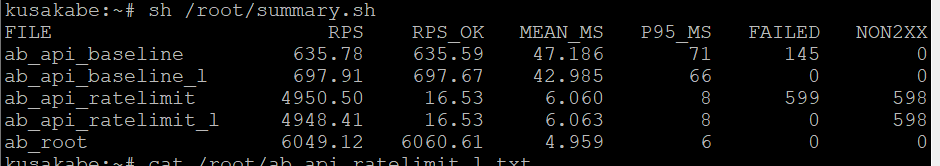
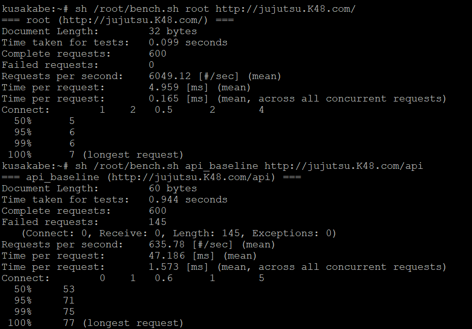
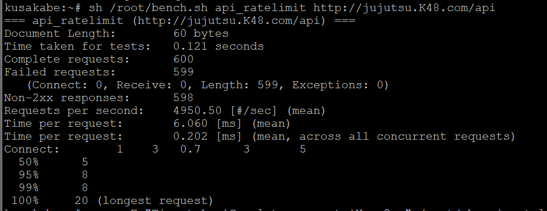
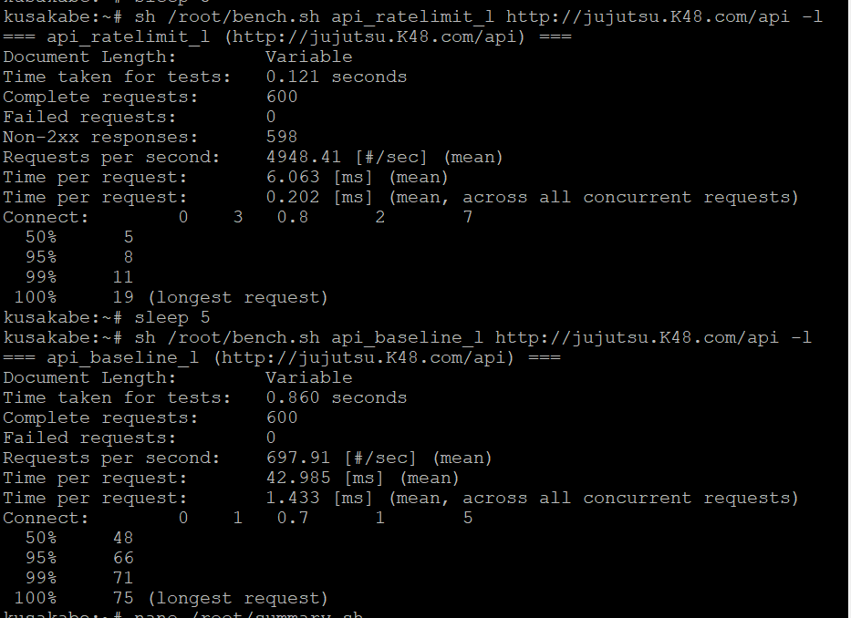
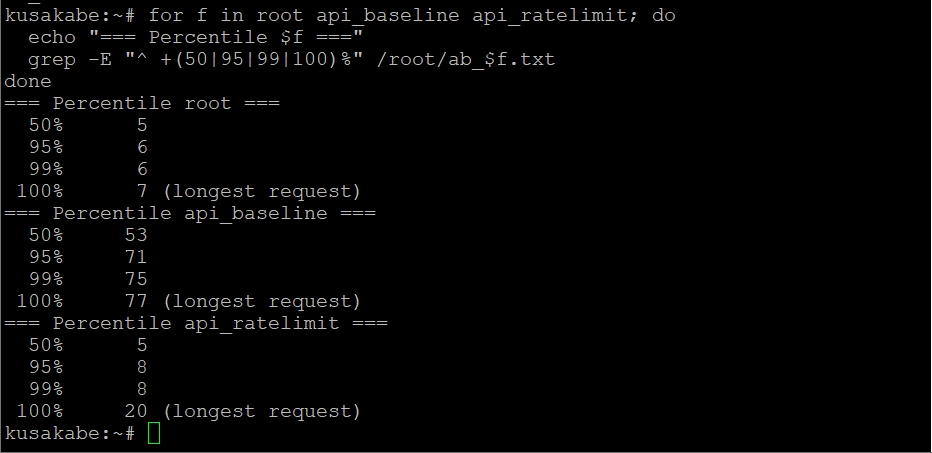
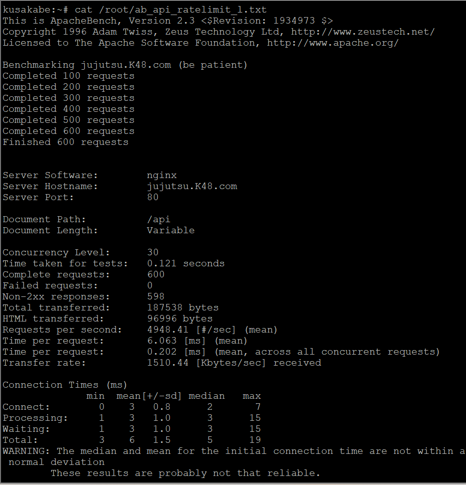
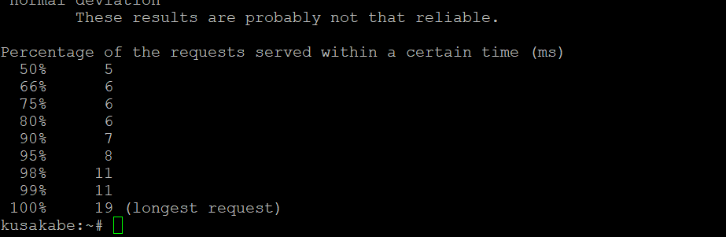
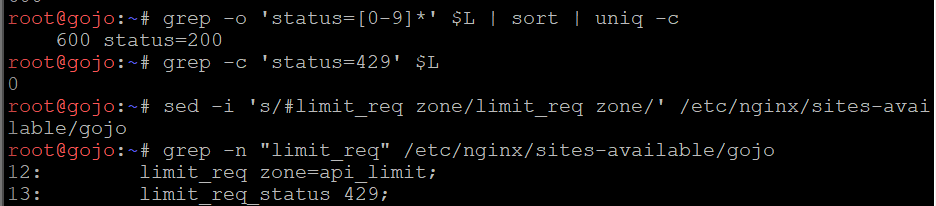
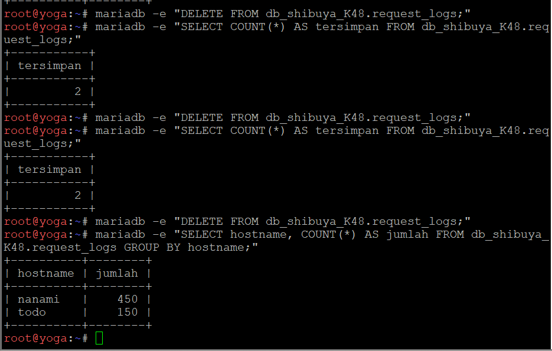

---

# Kendala

Tidak Terdapat kendala.

---

# Kesimpulan

- **DNS (11–12):** utahime (Master) dan shoko (Slave) menyinkronkan zona forward dan reverse secara otomatis. Domain utama mengarah ke gojo, `www` berupa CNAME, PTR tersedia, dan forwarder ke `192.168.122.1` membuat klien tetap bisa menjangkau internet.
- **Database (13):** yaga (Master) dan inumaki (Slave) bereplikasi real-time dengan binary log. User remote dibatasi pada `192.235.4.%`, dan replikasi tetap sehat (`Yes`/`Yes`) pada pemeriksaan akhir.
- **Worker (14):** maki dan panda menyajikan frontend, nanami, todo, dan kirara menyajikan API yang mencatat ke database. Akses langsung klien ke worker ditolak (`403`).
- **Load balancer dan reverse proxy (15–16):** geto membagi beban API dengan Weighted Round Robin 3:1, dan gojo meneruskan `/` ke frontend dan `/api` ke geto.
- **IP klien asli (17):** header `X-Real-IP` dan `X-Forwarded-For` diteruskan, geto hanya mempercayai gojo, dan database mencatat IP klien yang sebenarnya, terbukti tahan terhadap pemalsuan header (`spoofed = 0`).
- **Ketersediaan (18):** kirara menjadi backup dengan passive health check. Saat nanami dan todo mati, `/api` tetap dijawab oleh kirara tanpa `502`, dan setelah dipulihkan distribusi kembali 3:1.
- **Optimasi dan pembatasan (19):** proxy cache 10 menit dengan header `X-Cache-Status` (MISS lalu HIT), dan rate limiting `/api` 10 request per detik per IP (28 dari 30 request ditolak `429`).
- **Pengujian beban (20):** halaman cache mencapai sekitar 6.049 RPS, `/api` baseline sekitar 636–698 RPS, dan rate limiting menolak 598 dari 600 request. Kegagalan aplikasi, koneksi, dan penolakan kebijakan dibedakan lewat log gojo, rincian `ab`, dan isi database.
